

  

  

  <a href="#about">About</a> &nbsp;·&nbsp;
  <a href="#projects">Projects</a> &nbsp;·&nbsp;
  <a href="#ai">AI</a> &nbsp;·&nbsp;
  <a href="#experience">Experience</a> &nbsp;·&nbsp;
  <a href="#toolkit">Toolkit</a> &nbsp;·&nbsp;
  <a href="#contact">Contact</a>

## About / 关于

<table>
<tr>
<td width="70%" valign="top">

我是 <strong>张宏扬</strong>，英文名 <strong>Aaron</strong>。同济大学信息管理与信息系统专业，2027 年毕业。接下来会继续读商业分析。

我喜欢把业务问题拆成数据问题：先弄清楚要做什么决策，再看数据能支持什么，最后用模型和分析给出可执行的判断。最近在做电商购买意图建模、供应链数据自动化，也在学因果推断和可解释机器学习。

这个主页放我做过的项目、常用的方法，以及一些正在学的东西。项目按时间与主题排列，不区分主次。

我也习惯用 AI 协作：从设计系统、工作流到数据项目，让 AI 帮我快速生成方案和原型，再由我判断、修改和收敛。

BUSINESS ANALYTICS · CAUSAL INFERENCE · INTERPRETABLE ML · SUPPLY CHAIN

同济大学 · 信息管理与信息系统 · 2022–2027

</td>
<td width="30%" align="center" valign="top">

<strong>Aaron Zhang</strong>

张宏扬 · @zhy031214

Shanghai · 2026

</td>
</tr>
</table>

## Projects / 项目

> 18 个项目，按时间与主题排列，不区分主次。每个项目都对应一个完整案例页：关键数据、图表、结论和边界。内部项目不放公司数据或系统截图。

<table>
<tr>
<td width="33%" valign="top">

<a href="./projects/10-purchase-intent-modeling.md">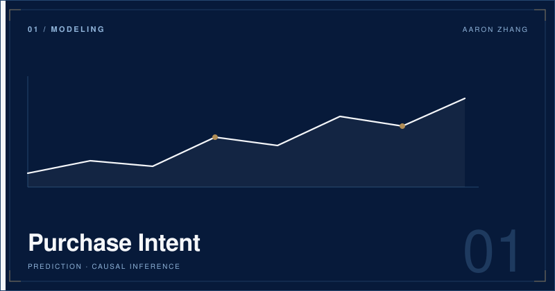</a>

<strong>电商购买意图建模</strong>

MODELING · 2026.11

12,330 条会话；PR-AUC 0.729；AIPW 周末效应 +1.59pp。

<a href="./projects/10-purchase-intent-modeling.md">查看详情 →</a>

</td>
<td width="33%" valign="top">

<a href="./projects/14-two-child-policy.md">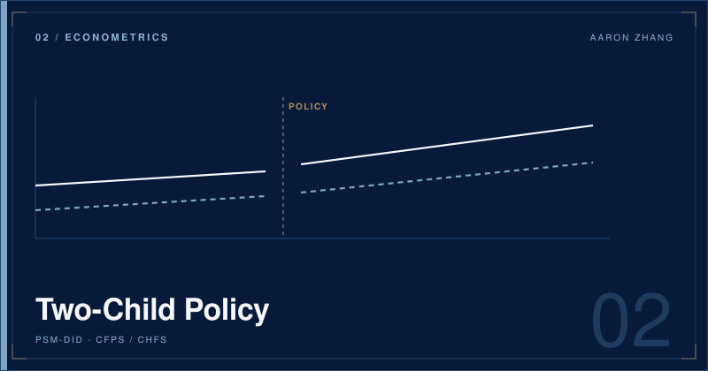</a>

<strong>全面二孩政策复现</strong>

ECONOMETRICS · 2025 秋

CFPS / CHFS；PSM-DID；复现四组准实验。

<a href="./projects/14-two-child-policy.md">查看详情 →</a>

</td>
<td width="33%" valign="top">

<a href="./projects/13-bike-dispatch.md">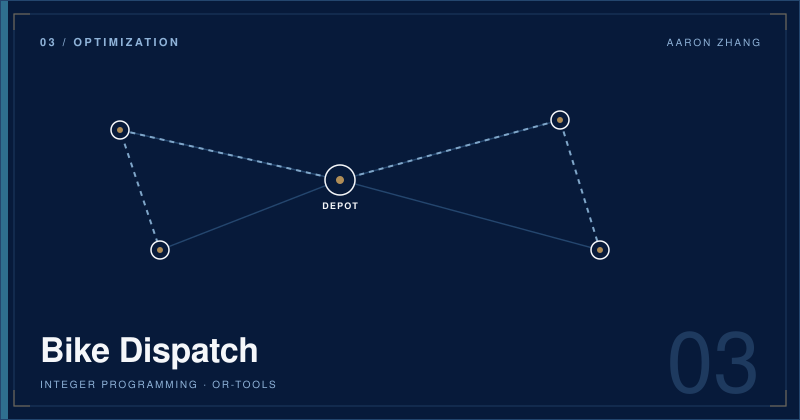</a>

<strong>哈啰单车调度优化</strong>

OPTIMIZATION · 2024 秋

4 个需求点、3 辆车；整数规划 + OR-Tools。

<a href="./projects/13-bike-dispatch.md">查看详情 →</a>

</td>
</tr>
<tr>
<td width="33%" valign="top">

<a href="./projects/15-quality-fmea.md">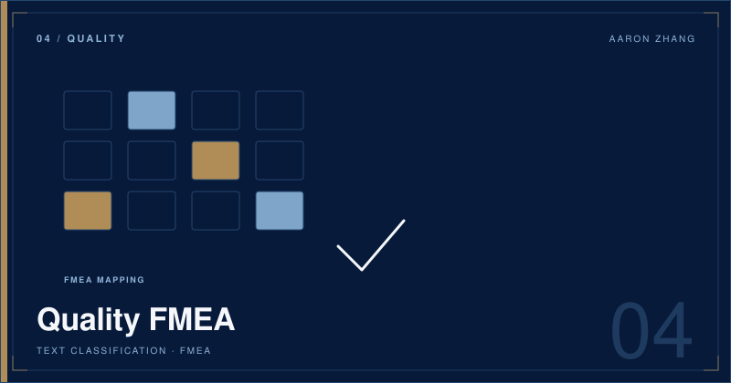</a>

<strong>质量风险文本分析</strong>

QUALITY · 2026 春

1,499 条投诉；6 个群体；FMEA 错误码。

<a href="./projects/15-quality-fmea.md">查看详情 →</a>

</td>
<td width="33%" valign="top">

<a href="./projects/08-deepseek-research.md">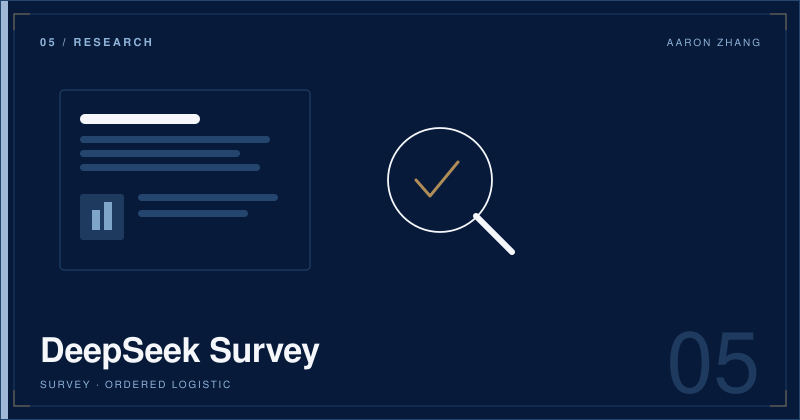</a>

<strong>正大杯 · DeepSeek 调研</strong>

RESEARCH · 2024.12–2025.06

462 份问卷；有序 Logistic；全国三等奖。

<a href="./projects/08-deepseek-research.md">查看详情 →</a>

</td>
<td width="33%" valign="top">

<a href="./projects/01-supplier-automation.md">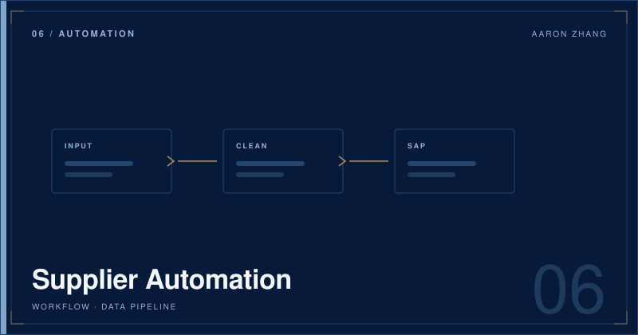</a>

<strong>供应商门户数据自动化</strong>

AUTOMATION · 2026.07–

订单整理 20–40 分钟/天 → 1 分钟。

<a href="./projects/01-supplier-automation.md">查看详情 →</a>

</td>
</tr>
<tr>
<td width="33%" valign="top">

<a href="./projects/02-sales-monitoring.md">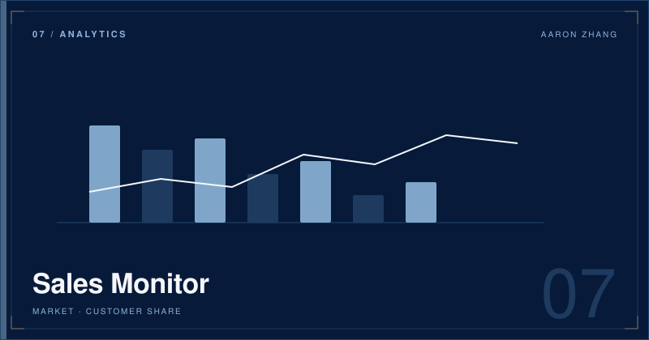</a>

<strong>车型销量监测</strong>

ANALYTICS · 2026.07–

103 品牌 / 738 车系 / 2000 万+ 终端销量。

<a href="./projects/02-sales-monitoring.md">查看详情 →</a>

</td>
<td width="33%" valign="top">

<a href="./projects/03-policy-parser.md">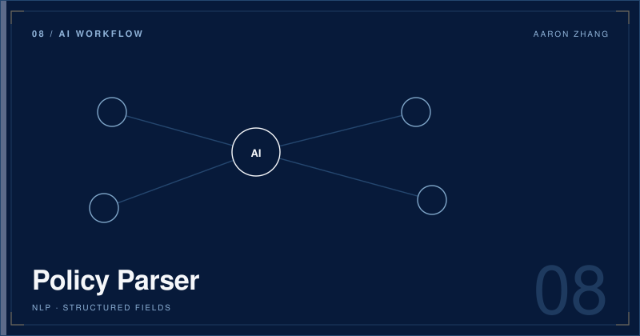</a>

<strong>政策文本解析</strong>

AI WORKFLOW · 2026.07–

300+ 条记录；角色化摘要 + 原文定位。

<a href="./projects/03-policy-parser.md">查看详情 →</a>

</td>
<td width="33%" valign="top">

<a href="./projects/04-production-dashboard.md">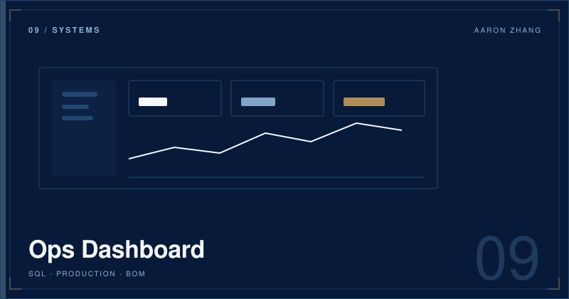</a>

<strong>生产数据看板与 BOM</strong>

SYSTEMS · 2025.07–09

SQL 看板；10 款产品 BOM 口径统一。

<a href="./projects/04-production-dashboard.md">查看详情 →</a>

</td>
</tr>
<tr>
<td width="33%" valign="top">

<a href="./projects/05-ai-invoice-agent.md">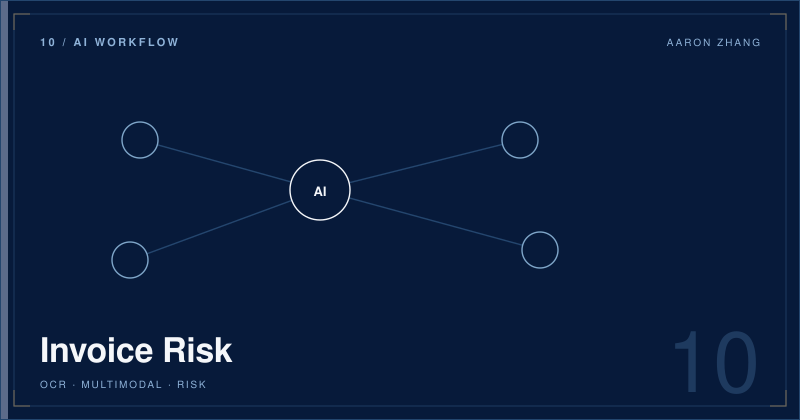</a>

<strong>发票风险识别智能体</strong>

AI WORKFLOW · 2025.12–

Coze + OCR；异常发票识别。

<a href="./projects/05-ai-invoice-agent.md">查看详情 →</a>

</td>
<td width="33%" valign="top">

<a href="./projects/06-ai-bookkeeping-agent.md">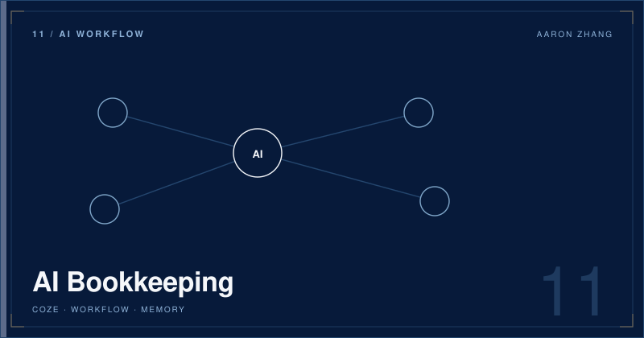</a>

<strong>AI 记账智能体</strong>

AI WORKFLOW · 2025.11–12

Coze 工作流；课程设计 A+。

<a href="./projects/06-ai-bookkeeping-agent.md">查看详情 →</a>

</td>
<td width="33%" valign="top">

<a href="./projects/07-pwc-asset-dashboard.md">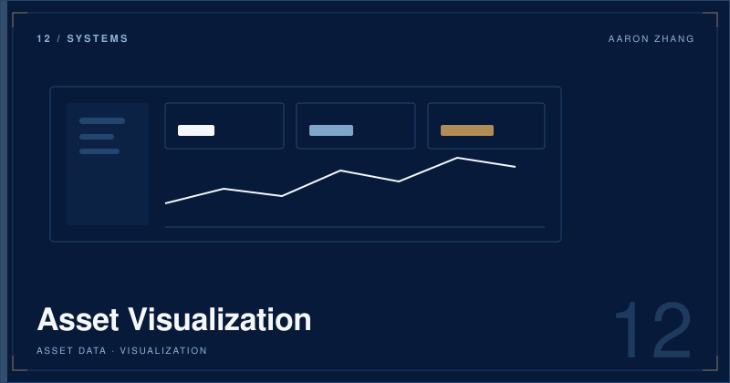</a>

<strong>普华永道资产可视化</strong>

SYSTEMS · 2025.10–11

600 台设备；8 个部门资产盘点。

<a href="./projects/07-pwc-asset-dashboard.md">查看详情 →</a>

</td>
</tr>
<tr>
<td width="33%" valign="top">

<a href="./projects/11-fragrance-website.md">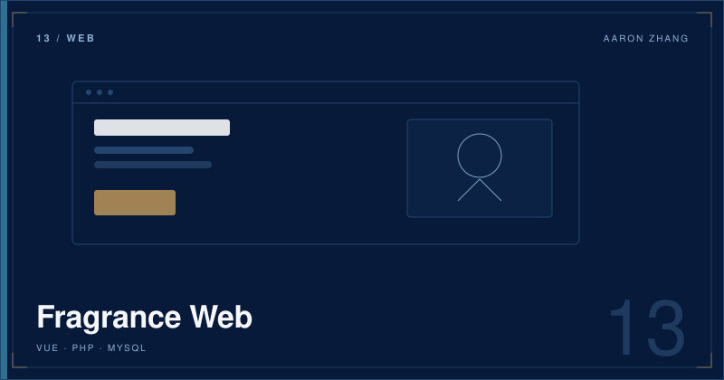</a>

<strong>Fragrance Roaming 香水站</strong>

WEB · 2025.07–08

100+ 用户 / 2,700 浏览；课程 A+ 第一。

<a href="./projects/11-fragrance-website.md">查看详情 →</a>

</td>
<td width="33%" valign="top">

<a href="./projects/12-epidemic-modeling.md">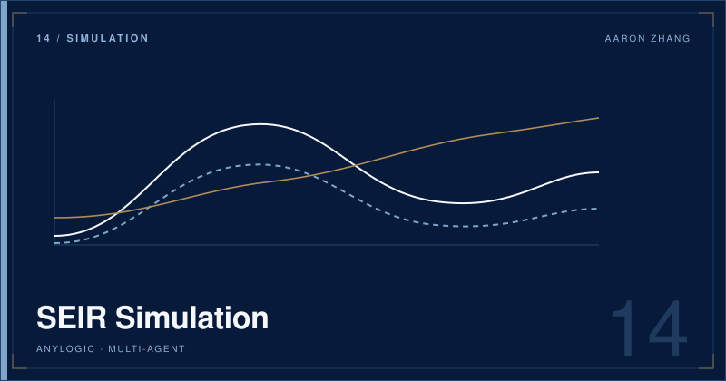</a>

<strong>疫情传播模型</strong>

SIMULATION · 2025.07–08

AnyLogic SEIR；19 个关键参数；A+。

<a href="./projects/12-epidemic-modeling.md">查看详情 →</a>

</td>
<td width="33%" valign="top">

<a href="https://github.com/zhy031214/customs-policy-crawler">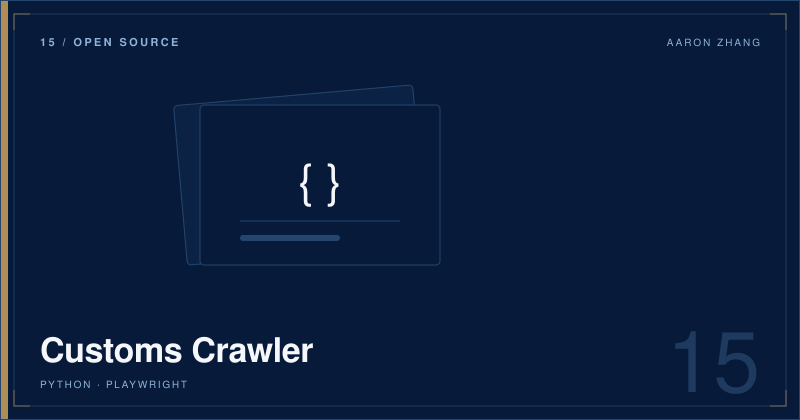</a>

<strong>海关政策监控爬虫</strong>

OPEN SOURCE · 2025

Python + Playwright；GitHub Actions 每日运行。

<a href="https://github.com/zhy031214/customs-policy-crawler">GitHub →</a>

</td>
</tr>
<tr>
<td width="33%" valign="top">

<a href="./projects/09-brand-planning.md">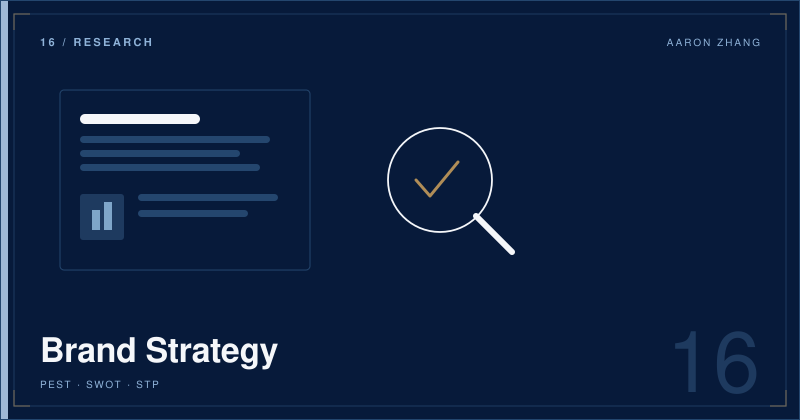</a>

<strong>恩施润邦 · 品牌策划</strong>

RESEARCH · 2025.01–08

全国一等奖；Logo / 包装被企业采纳。

<a href="./projects/09-brand-planning.md">查看详情 →</a>

</td>
<td width="33%" valign="top">

<a href="./projects/17-bookshare.md">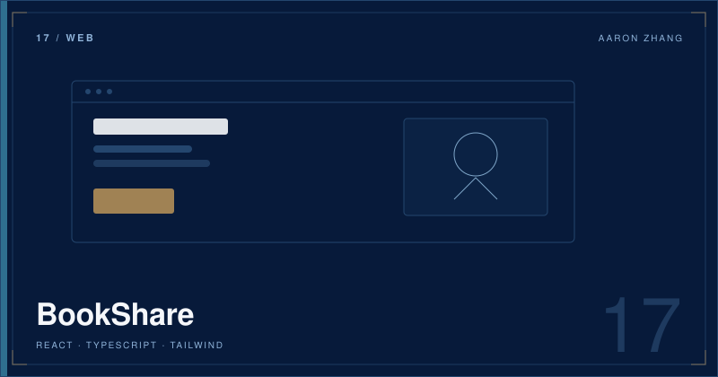</a>

<strong>BookShare 书籍分享站</strong>

WEB · 2025 秋

5 个页面；搜索 / 筛选 / 收藏 / 书架。

<a href="./projects/17-bookshare.md">查看详情 →</a>

</td>
<td width="33%" valign="top">

<a href="./projects/18-design-system.md">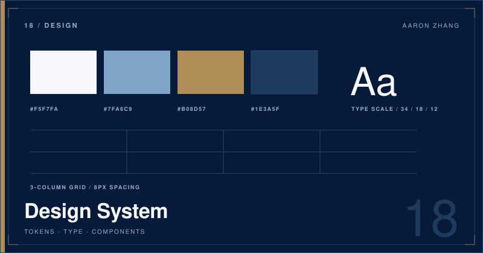</a>

<strong>Design System</strong>

DESIGN · 2026.11

颜色 / 字体 / 网格 / 缩略图；与 AI 协作迭代。

<a href="./projects/18-design-system.md">查看详情 →</a>

</td>
</tr>
</table>

全部案例索引：<a href="./projects/">projects/</a>

## Project Notes / 项目详情

> 所有项目默认展开，点击标题可以收起；完整案例页含关键数据、图表和结论。

<strong>电商购买意图建模</strong> · PR-AUC 0.729 / AIPW +1.59pp

<strong>问题：</strong>购买会话只占 15.47%，准确率会虚高；要识别高意向会话，并把预测与周末因果效应分开。

<strong>方法：</strong>分层 80/20、五折 CV、PR-AUC、Pipeline 防泄漏、折外阈值 0.415、SHAP、IPW/AIPW，以及移除 PageValues 的稳健性检查。

<strong>结果：</strong>RandomForest 测试集 PR-AUC 0.7290、ROC-AUC 0.9199、F1 0.6614；AIPW 周末效应 +1.59pp（95% CI [+0.03, +3.10]）。

<a href="./projects/10-purchase-intent-modeling.md">完整案例 →</a>

<strong>全面二孩政策复现</strong> · CFPS/CHFS + PSM-DID

<strong>问题：</strong>全面二孩政策是否改变家庭时间偏好，并进一步影响储蓄—消费结构。

<strong>方法：</strong>CFPS 2010–2020、CHFS 2013–2019；跨期消费欧拉方程测算时间偏好率；Logit 倾向得分 + 1:1 匹配 + DID；复现四组准实验；Stata 清洗。

<strong>结果：</strong>复现结果与原文核心方向基本一致：政策降低政策敏感型家庭的时间偏好率，并存在经济脆弱性、健康、预期等异质性。这是复现作业，不声称原创。

<a href="./projects/14-two-child-policy.md">完整案例 →</a>

<strong>哈啰单车调度优化</strong> · 整数规划 + OR-Tools

<strong>问题：</strong>4 个需求点、3 辆不同容量/运价的车、100 辆单车，在需求上下限和车辆容量约束下优化成本与利润。

<strong>方法：</strong>决策变量 x_ij；目标函数为需求点利润减运输成本；约束覆盖需求上下限、车辆容量、配送中心往返和非负整数；用 OR-Tools 的 SCIP 求解。

<strong>结果：</strong>输出每辆车的配送量与路径方案；课程报告结论为降低运输成本、提高利润。报告没有统一的最优值前后对比，不补造百分比。

<a href="./projects/13-bike-dispatch.md">完整案例 →</a>

<strong>质量风险文本分析</strong> · 1,499 条投诉 / FMEA

<strong>问题：</strong>淘宝闪购、美团外卖的投诉分散在消费者、商家、骑手三端，需要变成可分角色查看的质量风险数据。

<strong>方法：</strong>清洗投诉文本；标注消费者/商家/骑手身份；映射到 FMEA 错误码并记录 mapping_reason；整理成 6 个结构化 CSV。

<strong>结果：</strong>1,499 条记录；骑手端 Q1 最多（601 条），消费者端 X1/X3 为 248/203 条，商家端 S2 为 75 条。案例页只展示聚合统计。

<a href="./projects/15-quality-fmea.md">完整案例 →</a>

<strong>正大杯 · DeepSeek 智能化普惠调研</strong> · 462 份问卷 / 三端分析 / 全国三等奖

<strong>问题：</strong>在 AI 崛起背景下，DeepSeek 如何以低成本技术扩散撬动「普惠杠杆」？研究从政府、企业、用户三个层面回答技术崛起如何转化为社会福祉。

<strong>方法：</strong>线上（文献、爬虫、线上访谈）+ 线下（街采、预调查、正式调查、补充调查）；深度访谈 + Nvivo 编码；Python 爬取小红书/微博；上海 16 区分层抽样，回收 462 份有效问卷；预调查/正式调查做 Cronbach's α 与 KMO/Bartlett 检验。

<strong>结果：</strong>RFM 聚类做用户分层；随机森林识别分层因素；有序 Logistic 分析付费意愿（性能 OR=1.62, 95% CI [1.32,1.98]；用户体验 OR=0.80；服务支持不显著）；LSTM 做情感分类 + 词云；支付意愿做分组统计。

政府端呈现服务/成本/知识三类普惠；企业端呈现头部效应、行业分化和长尾潜力，接入对股价有正向影响；用户端形成「社交媒体引流 + 新闻权威扩散 + 亲友口碑」的复合传播模式。

成果：60 页研究报告、答辩 PPT、问卷与数据附录；全国三等奖（995 所高校、28 万+ 人报名）。我作为核心组员全程参与研究设计、数据采集、建模和报告撰写。

<a href="./projects/08-deepseek-research.md">完整案例 →</a>

<strong>供应商门户数据自动化</strong> · 20–40 分钟/天 → 1 分钟

<strong>问题：</strong>天津、沈阳两座工厂的供应商订单需要人工逐条整理，覆盖小米、宝马等客户 50+ 零件号，还要清洗后录入 SAP。

<strong>方法：</strong>拆解 SAP 所需字段；Python/浏览器自动化抓取；多维去重、校验、标准化；增加异常标记和人工复核入口。

<strong>结果：</strong>小米订单整理 20–40 分钟/天 → 1 分钟；宝马 15 分钟/天 → 1 分钟；人工整理环节被自动化流程替代。

<a href="./projects/01-supplier-automation.md">完整案例 →</a>

<strong>车型销量监测与客户份额分析</strong> · 103 品牌 / 738 车系

<strong>问题：</strong>需要同时看市场端车型销量和供应端实际供货，判断车型滞销与客户份额流失。

<strong>方法：</strong>懂车帝车型销量爬虫；清洗车型改名/车系归属/重复记录；按月汇总 12 个月滚动数据；与公司供货量交叉比对，构建供货占比指标。

<strong>结果：</strong>103 个品牌、738 个车系、累计终端销量 2000 万+；形成「车型滞销 vs 客户份额流失」诊断框架，支撑客户维护与供应决策。

<a href="./projects/02-sales-monitoring.md">完整案例 →</a>

<strong>政策文本智能解析</strong> · 300+ 条记录

<strong>问题：</strong>政策文件长、结构不统一，不同业务角色关注点不同，人工检索和摘录成本高。

<strong>方法：</strong>解析政策文本并分段；按业务角色生成要点摘要；保留原文位置索引；抽取主题、适用对象、关键条款等结构化字段。

<strong>结果：</strong>累计解析 300+ 条记录，工具被团队持续使用；摘要可回溯原文，降低误读和二次确认成本。

<a href="./projects/03-policy-parser.md">完整案例 →</a>

<strong>生产数据看板与 BOM 治理</strong> · SQL + 10 款产品

<strong>问题：</strong>车间生产数据分散，质检工程师需要反复查询；10 款产品的 BOM 命名和层级口径不统一。

<strong>方法：</strong>SQL 搭建车间看板模板；实现生产数据 CRUD；统一 BOM 物料命名/层级/字段；参与 sMES 模拟验证和墨西哥设厂网络运营商选型。

<strong>结果：</strong>看板供质检工程师日常使用；BOM 口径统一；选型报告被采纳；两度获评最佳实习生（同期 20 人）。

<a href="./projects/04-production-dashboard.md">完整案例 →</a>

<strong>发票风险识别智能体</strong> · Coze + OCR / 多模态

<strong>问题：</strong>高校报销发票数量多，娱乐场所关联、金额超规等异常靠人工审核容易漏。

<strong>方法：</strong>设计「信用画像 + AI 智能体」流程；Coze + 同济 Agent 平台；OCR/多模态提取字段；规则识别异常；保留人工复核。

<strong>结果：</strong>SITP 项目立项，完成发票识别智能体原型与流程验证；目前仍处于原型/试点阶段。

<a href="./projects/05-ai-invoice-agent.md">完整案例 →</a>

<strong>AI 记账与任务规划智能体</strong> · Coze 工作流 / A+

<strong>问题：</strong>记账和任务管理分散在两个工具；LLM 容易遗忘上下文、编造金额或待办。

<strong>方法：</strong>Coze（Kimi-K2、豆包 1.5 Pro）；意图识别 + 槽位抽取 + 多数据库记忆；语言风格切换；查询式回答降低幻觉。

<strong>结果：</strong>独立完成可运行工作流智能体，课程设计 A+；把记账、任务、风格切换放进同一对话入口。

<a href="./projects/06-ai-bookkeeping-agent.md">完整案例 →</a>

<strong>普华永道资产可视化</strong> · 600 台设备 / 8 个部门

<strong>问题：</strong>电脑分布在不同部门，配置、序列号、使用人信息分散；离职数据备份和 PC 回收容易遗漏。

<strong>方法：</strong>资产台账采集与维护；两个月完成 600 台电脑配置迁移；建立离职备份/回收流程；绘制带序列号的资产分布图；参与 Agent 测试。

<strong>结果：</strong>600 台设备、8 个部门；资产分布可视化，盘点与调度效率提升。

<a href="./projects/07-pwc-asset-dashboard.md">完整案例 →</a>

<strong>Fragrance Roaming 香水站</strong> · Vue + PHP + MySQL

<strong>问题：</strong>香水信息、社区讨论和门店位置分散，新手与进阶用户都缺少一站式入口。

<strong>方法：</strong>香水数据库 + 论坛；阿里云 AI 推荐；高德地图 API；HTML/CSS/JS + Bootstrap/AJAX/Vue；MySQL + Navicat + PHP。

<strong>结果：</strong>运营一个月 100+ 用户、2,700 页面浏览；课程 A+、同届第一。

<a href="./projects/11-fragrance-website.md">完整案例 →</a>

<strong>疫情传播模型</strong> · AnyLogic SEIR / 19 个参数

<strong>问题：</strong>用可解释模型描述疾病传播，并为防控策略提供参考。

<strong>方法：</strong>AnyLogic 多智能体 SEIR 状态图；Java 实现感染逻辑；系统动力学拟合历史数据；自动校准 19 个参数；加入人口流动、死亡和群体免疫。

<strong>结果：</strong>多智能体与系统动力学结果对齐；课程 A+、同届第一。

<a href="./projects/12-epidemic-modeling.md">完整案例 →</a>

<strong>海关政策监控爬虫</strong> · Python + Playwright

<strong>问题：</strong>海关总署政策栏目有加速乐 WAF，纯 requests 会被 412 拦截；人工每天查新成本高。

<strong>方法：</strong>Playwright 无头浏览器完成 JS 挑战拿 Cookie；requests 抓分页接口；MD5 去重；Excel 历史台账；QQ 邮箱 SMTP 推送；GitHub Actions 每日运行。

<strong>结果：</strong>每日北京时间 10:00 自动抓取新政策并邮件推送；开源在 GitHub。

<a href="https://github.com/zhy031214/customs-policy-crawler">完整案例 →</a>

<strong>恩施润邦 · 品牌策划</strong> · 全国一等奖

<strong>问题：</strong>恩施润邦茶业有产地资源，但品牌辨识度弱，年轻消费者对「恩施硒茶」认知有限。

<strong>方法：</strong>实地调研；PEST/SWOT/波特五力/CAMP-S；STP 定位；提出「硒都」品牌叙事；策划快闪店和「硒力青年计划」；50 万元级流媒体预算与 KPI。

<strong>结果：</strong>全国一等奖（700+ 高校、1 万+ 队伍）；新 Logo 与包装方案被企业采纳落地。

<a href="./projects/09-brand-planning.md">完整案例 →</a>

<strong>BookShare 书籍分享站</strong> · React / TypeScript / Tailwind

<strong>问题：</strong>书籍推荐、收藏和笔记分散在电商、社交平台和工具里，需要一个更轻的浏览与分享入口。

<strong>方法：</strong>Vite + React 18 + TypeScript + Tailwind + React Router；首页/浏览/详情/发布/书架 5 个页面；搜索、多标签筛选、排序、收藏和书架状态。

<strong>结果：</strong>完成可运行前端原型，响应式布局与玻璃拟态卡片；课程项目，目前没有公开 Demo。

<a href="./projects/17-bookshare.md">完整案例 →</a>

<strong>Design System · 个人主页视觉系统</strong> · Tokens / 18 张缩略图 / AI 协作

<strong>问题：</strong>18 个项目类型差异很大，如果每个项目用不同封面和排版，页面会失去秩序。

<strong>方法：</strong>定义学院蓝/金色 tokens、字体层级、8px 间距、3 列网格；用统一 SVG 模板生成 18 张缩略图；组件化项目卡；AI 生成候选，人负责筛选、收敛和 QA。

<strong>结果：</strong>18 个项目统一尺寸、统一结构；新增项目只需一张缩略图 + 一张卡片 + 一个案例页。

<a href="./projects/18-design-system.md">完整案例 →</a>

## AI Collaboration / AI 协作

> 我用 AI 不是让它替我“写完”，而是把它当成协作工具：我负责问题、判断和取舍，AI 负责快速生成方案、代码、图表和文字草稿，再由我修改和收敛。

<table>
<tr>
<td width="33%" valign="top">

<strong>Design Systems</strong>

用 AI 生成颜色、字体、间距、组件和缩略图变体，再人工筛选、统一。例：这个主页的 tokens、18 张缩略图和 3 列网格。

</td>
<td width="33%" valign="top">

<strong>Workflows</strong>

把业务流程拆成步骤，用 AI 写脚本、搭 Agent、做检查清单。例：供应商数据自动化、政策解析、AI 记账。

</td>
<td width="33%" valign="top">

<strong>Analysis</strong>

用 AI 加速数据清洗、建模迭代、图表和文档；结论和边界由我判断。例：购买意图建模、质量 FMEA。

</td>
</tr>
</table>

## Experience / 经历

<table>
<tr>
<td width="20%" valign="top"><strong>2026.07 – 至今</strong></td>
<td width="80%" valign="top">

<strong>本特勒（中国）</strong> · 供应链数字化实习

供应商需求数据自动化 · 车型销量监测与客户份额分析 · 政策文本解析

</td>
</tr>
<tr>
<td width="20%" valign="top"><strong>2025.10 – 2025.11</strong></td>
<td width="80%" valign="top">

<strong>普华永道中天会计师事务所</strong> · FCS-GTS 部门 · 资产数据管理与可视化

600 台设备配置与迁移 · 8 个部门资产盘点 · 资产分布可视化

</td>
</tr>
<tr>
<td width="20%" valign="top"><strong>2025.07 – 2025.09</strong></td>
<td width="80%" valign="top">

<strong>青岛 Carflex 汽车配件有限公司</strong> · IT 部门实习 · 生产数据与 BOM 治理

SQL 生产看板 · BOM 数据治理 · 墨西哥设厂网络运营商选型

</td>
</tr>
</table>

## Toolkit / 工具

<table>
<tr>
<td width="50%" valign="top">

<strong>Data &amp; Programming</strong>

Python · SQL / MySQL · pandas · NumPy · scikit-learn · Git

</td>
<td width="50%" valign="top">

<strong>Modeling &amp; Inference</strong>

Ordered Logistic · RandomForest · HistGradientBoosting · Cross-validation · SHAP · IPW / AIPW

</td>
</tr>
<tr>
<td width="50%" valign="top">

<strong>Analytics &amp; Automation</strong>

SPSS · EViews · Excel · FineReport · Matplotlib · Playwright · GitHub Actions

</td>
<td width="50%" valign="top">

<strong>Web &amp; AI</strong>

React · TypeScript · Tailwind · PHP · MySQL · Coze · OCR · AnyLogic

</td>
</tr>
</table>

正在学：因果推断、可解释机器学习、LLM 工作流。

## Contact / 联系

<a href="https://github.com/zhy031214">GitHub</a> &nbsp;·&nbsp; CV available on request

Shanghai · 2026

  

