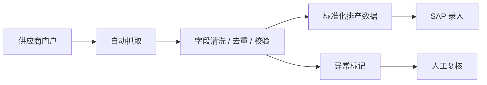
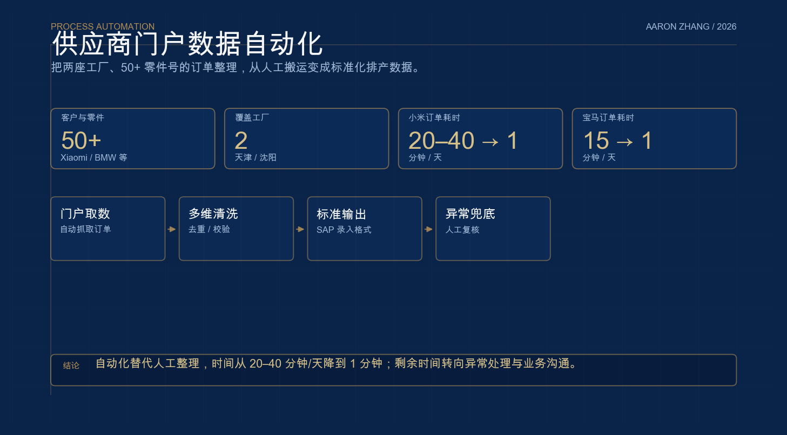

[← 返回主页](../README.md)

# 供应商门户数据自动化

> 把天津、沈阳两座工厂的供应商订单，从每天人工整理变成标准化排产数据，直接进入 SAP 录入流程。

<table>
<tr>
<td><strong>公司</strong></td>
<td>本特勒投资（中国）有限公司</td>
</tr>
<tr>
<td><strong>时间</strong></td>
<td>2026.07 – 至今</td>
</tr>
<tr>
<td><strong>角色</strong></td>
<td>供应链数字化实习生 · 独立开发</td>
</tr>
<tr>
<td><strong>关键词</strong></td>
<td><code>Python</code> <code>浏览器自动化</code> <code>数据清洗</code> <code>Excel / SAP</code></td>
</tr>
</table>

## 背景 / Context

天津、沈阳两座工厂的供应商订单需要人工从供应商门户逐条整理。订单覆盖小米、宝马等整车厂客户，涉及 **50+ 零件号**，还要按零件号、功能、日期、紧急程度等多个维度清洗、汇总，最后整理成可以录入 SAP 的标准化排产数据。

原来的流程高度依赖人工：每天重复打开页面、复制字段、核对格式、拼接表格。单是小米订单，每天就要花 **20–40 分钟**；宝马订单约 **15 分钟/天**。数据分散、口径不统一，也容易出现漏项和格式错误。

## 我的工作 / What I did

我独立开发了一套供应商门户数据抓取工作流，把「取数 → 清洗 → 汇总 → 输出」串成一条可重复执行的流程：

1. **拆字段**：和业务使用方确认 SAP 录入所需的字段、顺序、格式和必填规则。
2. **自动取数**：从供应商门户抓取订单数据，减少逐条复制。
3. **多维清洗**：按零件号、功能、日期、紧急程度去重、归并、校验。
4. **标准化输出**：生成可直接用于排产的表格，对齐 SAP 录入格式。
5. **异常兜底**：对缺失字段、格式异常、重复记录做标记，保留人工复核入口。

## 结果 / Impact

- 小米订单整理耗时：**20–40 分钟/天 → 1 分钟**
- 宝马订单整理耗时：**15 分钟/天 → 1 分钟**
- 以自动化流程**完全替代人工整理环节**，把时间从重复搬运转回异常处理和业务沟通。

## 关键数据 / Key Numbers

| 指标 | 数值 | 口径 |
|---|---|---|
| 客户 / 零件号 | 50+ 零件号 | 小米、宝马等整车厂客户 |
| 覆盖工厂 | 2 座 | 天津、沈阳 |
| 小米订单整理 | 20–40 分钟/天 → 1 分钟 | 原人工流程 vs 自动化后 |
| 宝马订单整理 | 15 分钟/天 → 1 分钟 | 原人工流程 vs 自动化后 |
| 异常处理 | 人工复核 | 缺失字段、重复记录、格式异常 |

图：从门户取数、清洗、标准化输出到异常复核的流程；右侧为两座工厂的耗时变化口径。

## 结论 / Takeaways

- **先定义输出，再倒推输入**：SAP 需要什么字段、什么顺序、什么格式，决定了抓取和清洗的规则；这比“先抓下来再说”更可靠。
- **自动化的收益来自消除重复搬运**：真正省下的是复制、格式转换和逐条核对的时间，而不是让系统替人做业务判断。
- **异常必须留入口**：缺失字段、重复记录、格式不一致仍然需要人工复核；自动化把人的时间从搬运转到异常处理。

## 可迁移的能力 / What it shows

- **业务流程拆解**：先定义输出，再倒推需要哪些字段和步骤。
- **数据质量意识**：去重、校验、异常兜底，而不是「抓下来就算完成」。
- **用户视角**：工具最终要给业务同事用，格式和可解释性比技术炫技更重要。

---

> **说明**：该项目为实习期间内部项目。以上仅展示问题拆解、方法和个人贡献，不包含公司数据、系统截图或源代码；部分细节已做脱敏和概括处理。
