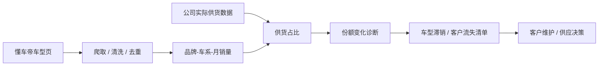
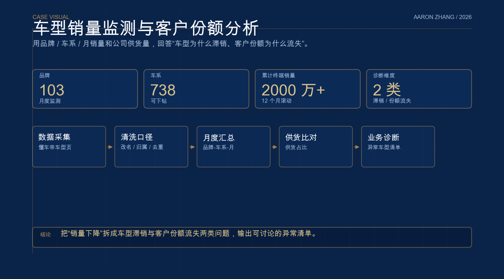

[← 返回主页](../README.md)

# 车型销量监测与客户份额分析

> 用 103 个品牌、738 个车系的月度终端销量，搭建一套能回答「车型为什么滞销、客户份额为什么流失」的监测体系。

<table>
<tr>
<td><strong>公司</strong></td>
<td>本特勒投资（中国）有限公司</td>
</tr>
<tr>
<td><strong>时间</strong></td>
<td>2026.07 – 至今</td>
</tr>
<tr>
<td><strong>角色</strong></td>
<td>供应链数字化实习生 · 搭建 / 维护</td>
</tr>
<tr>
<td><strong>关键词</strong></td>
<td><code>Python</code> <code>数据清洗</code> <code>Excel</code> <code>指标体系</code></td>
</tr>
</table>

## 背景 / Context

公司需要同时看两件事：

1. **市场端**：整车厂客户的车卖得怎么样？哪些车型在增长，哪些在滞销？
2. **供应端**：公司实际供货量是多少？供货占比是否在变化？

原来的信息分散在外部平台和内部报表里，缺少一套按月更新、能按品牌 / 车系 / 月份下钻的监测口径，难以支撑客户关系维护和供应决策。

## 我的工作 / What I did

我编写了懂车帝车型销量爬取脚本，并搭建月度销量监测体系：

- **数据采集**：抓取车型销量数据，覆盖 **103 个品牌、738 个车系**。
- **时间窗口**：维护 **12 个月滚动数据**，累计终端销量超过 **2000 万辆**。
- **清洗汇总**：按月统计终端销量，处理车型改名、车系归属、重复记录等口径问题。
- **交叉比对**：把终端销量与公司实际供货量对齐，计算供货占比。
- **指标下钻**：按品牌、车系、月份三个维度拆解，构建「车型滞销 vs 客户份额流失」诊断框架。
- **业务输出**：把异常车型、份额变化整理成可讨论的清单，支撑客户关系维护与供应决策。

## 结果 / Impact

- 建立覆盖 **103 个品牌、738 个车系、12 个月**的月度监测体系。
- 累计覆盖终端销量 **2000 万+**。
- 把「销量下降」从一句模糊判断，拆成可验证的 **车型滞销 / 客户份额流失** 两类问题，并给出下钻维度。

## 关键数据 / Key Numbers

| 指标 | 数值 | 口径 |
|---|---|---|
| 覆盖品牌 | 103 个 | 懂车帝车型销量 |
| 覆盖车系 | 738 个 | 可下钻到车系/月 |
| 时间窗口 | 12 个月滚动 | 月度更新 |
| 累计终端销量 | 2000 万+ | 覆盖车型的累计口径 |
| 诊断维度 | 2 类 | 车型滞销 / 客户份额流失 |

图：从懂车帝采集、清洗口径、月度汇总、供货比对到业务诊断的链路。

## 结论 / Takeaways

- **“销量下降”不是一个结论**：要先区分是市场端车型整体滞销，还是供应端在客户中的份额下降，两者对应完全不同的动作。
- **口径比爬虫更难**：车型改名、车系归属、重复记录、时间窗口，任何一个处理不一致都会让“份额变化”失真。
- **监测体系要能下钻**：品牌 → 车系 → 月份三层结构，才能把异常定位到可以讨论的具体车型。

## 可迁移的能力 / What it shows

- **指标设计**：从业务问题倒推指标，而不是堆报表。
- **数据口径治理**：车型改名、车系归属、时间窗口等细节决定分析是否可信。
- **从数据到决策**：不只输出数字，而是输出可以拿去讨论的异常清单和假设。

---

> **说明**：该项目为实习期间内部项目。以上仅展示问题拆解、方法和个人贡献，不包含公司数据、系统截图或源代码；部分细节已做脱敏和概括处理。
