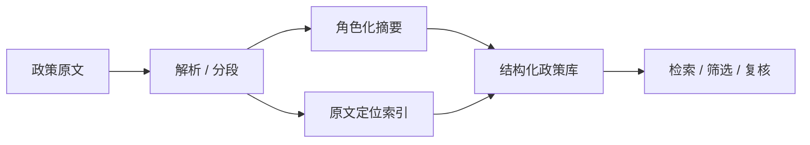
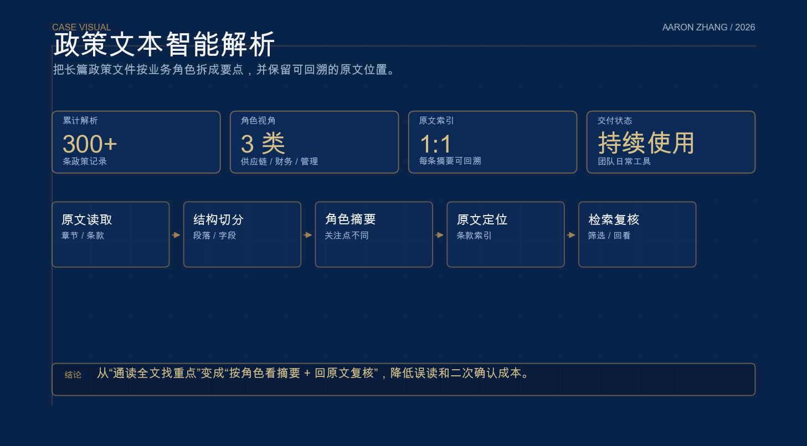

[← 返回主页](../README.md)

# 政策文本智能解析

> 把长篇、非结构化的政策文件，按不同业务角色自动归纳要点，并索引回原文位置，变成可检索的结构化信息。

<table>
<tr>
<td><strong>公司</strong></td>
<td>本特勒投资（中国）有限公司</td>
</tr>
<tr>
<td><strong>时间</strong></td>
<td>2026.07 – 至今</td>
</tr>
<tr>
<td><strong>角色</strong></td>
<td>供应链数字化实习生 · 开发 / 交付</td>
</tr>
<tr>
<td><strong>关键词</strong></td>
<td><code>Python</code> <code>文本解析</code> <code>结构化字段</code> <code>角色化摘要</code></td>
</tr>
</table>

## 背景 / Context

政策文件通常篇幅长、结构不统一，同一份文件对不同业务角色的影响也不同：供应链关心交付和通关，财务关心成本和合规，管理层关心方向和风险。

原来的做法是人工通读、摘录、转发，存在三个问题：

- **找得慢**：关键条款埋在大段文字里，检索成本高。
- **口径不一**：不同人摘出来的重点不一样。
- **无法追溯**：摘要和原文对不上，难以复核。

## 我的工作 / What I did

我开发了一个政策文件解析工具，把「原文 → 结构化 → 可检索」串起来：

1. **文本解析**：读取政策文件，按章节、条款、段落切分。
2. **角色化摘要**：针对不同业务角色，生成不同关注点的要点归纳。
3. **原文定位**：为每条摘要保留原文位置索引，点击可以回到出处。
4. **结构化存储**：把政策主题、适用对象、关键条款、时间节点等字段抽出来，形成可筛选的记录。
5. **持续使用**：工具交付给团队日常使用，累计解析记录 **300+ 条**。

## 结果 / Impact

- 累计解析 **300+ 条**政策记录，工具被团队持续使用。
- 把「通读全文找重点」变成「按角色看摘要 + 回原文复核」。
- 每条摘要可追溯，降低误读和二次确认成本。

## 关键数据 / Key Numbers

| 指标 | 数值 | 口径 |
|---|---|---|
| 累计解析 | 300+ 条 | 政策记录 |
| 角色视角 | 3 类 | 供应链 / 财务 / 管理层 |
| 原文索引 | 1:1 | 每条摘要保留原文位置 |
| 交付状态 | 持续使用 | 团队日常检索 |

图：原文读取、结构切分、角色化摘要、原文定位到检索复核的流程。

## 结论 / Takeaways

- **同一份政策，对不同角色不是同一件事**：供应链看交付和通关，财务看成本和合规，管理层看方向和风险；角色化摘要比“一份通用摘要”更有用。
- **摘要必须能回到原文**：没有原文索引的摘要不敢用于业务判断；可追溯性是这类工具能不能被真正使用的分界线。
- **先设计字段，再设计解析**：主题、适用对象、关键条款、时间节点这些字段决定了后续能不能筛选和复核。

## 可迁移的能力 / What it shows

- **信息架构**：先定义字段和检索方式，再决定怎么解析。
- **可追溯设计**：摘要必须能回到原文，才敢用于业务判断。
- **角色化思维**：同一份信息，对不同使用者要有不同的呈现方式。

---

> **说明**：该项目为实习期间内部项目。以上仅展示问题拆解、方法和个人贡献，不包含公司数据、系统截图或源代码；部分细节已做脱敏和概括处理。
