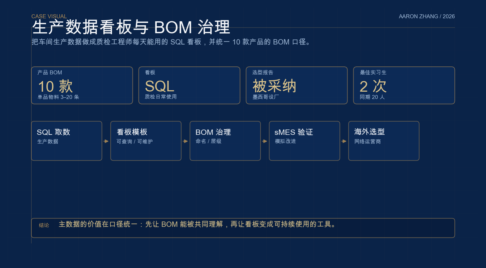

[← 返回主页](../README.md)

# 生产数据看板与 BOM 治理

> 用 SQL 把车间生产数据做成质检工程师每天能用的看板，并统一 10 款产品的 BOM 数据口径。

<table>
<tr>
<td><strong>公司</strong></td>
<td>青岛 Carflex 汽车配件有限公司</td>
</tr>
<tr>
<td><strong>时间</strong></td>
<td>2025.07 – 2025.09</td>
</tr>
<tr>
<td><strong>角色</strong></td>
<td>IT 部门实习 · 生产数据 / BOM 治理</td>
</tr>
<tr>
<td><strong>关键词</strong></td>
<td><code>SQL / MySQL</code> <code>数据看板</code> <code>BOM</code> <code>sMES</code></td>
</tr>
</table>

## 背景 / Context

车间生产数据分散在不同表格和系统里，质检工程师需要频繁查询、汇总和更新。原来的看板模板不统一，数据口径也不一致，容易出现「同一件事，不同表里数字对不上」的情况。

同时，公司有 10 款产品需要维护 BOM 清单，每款产品的单品物料在 **3–20 条**之间。物料命名、层级和配置关系不统一，会影响定制化配置和生产质检协同。

## 我的工作 / What I did

### 1. SQL 生产数据看板

- 独立搭建车间看板的数据模板。
- 用 SQL 完成生产数据的增删改查与日常维护。
- 把质检工程师常用的查询固化成模板，减少重复取数。
- 支撑生产数据的实时透明化，让异常更早被看到。

### 2. BOM 数据治理

- 维护 10 款产品的 BOM 清单，单品物料 3–20 条。
- 统一物料命名、层级和字段口径。
- 支持定制化配置与生产质检协同，减少「同名不同物 / 同物不同名」。

### 3. 生产线与海外选型项目

- 深度参与舍弗勒生产线项目：会议沟通、需求对接、纪要汇报。
- 通过 sMES 模拟验证改进方案，协助完善生产与质检规范。
- 参与墨西哥设厂网络运营商选型：多维度对比中国移动与中国电信方案，输出选型报告，**结论被采纳**并支持海外设厂决策。

## 结果 / Impact

- 看板模板供质检部门工程师日常使用，生产数据从「分散表格」变成「可查询的模板」。
- 10 款产品的 BOM 数据口径统一，支持定制化配置与质检协同。
- 墨西哥设厂网络运营商选型报告被采纳。
- 两度获评 **「最佳实习生」**（同期实习生共 20 人）。

## 关键数据 / Key Numbers

| 指标 | 数值 | 口径 |
|---|---|---|
| 产品 BOM | 10 款 | 单品物料 3–20 条 |
| 看板 | SQL 模板 | 质检工程师日常使用 |
| 生产线项目 | sMES 模拟验证 | 舍弗勒生产线 |
| 海外选型 | 墨西哥设厂 | 中国移动 vs 中国电信 |
| 最佳实习生 | 2 次 | 同期实习生 20 人 |

图：SQL 取数、看板模板、BOM 治理、sMES 验证与海外选型的项目链路。

## 结论 / Takeaways

- **主数据的价值在口径统一**：BOM 不是“表建得多”，而是同名同物、同物同名，配置和质检才能对得上。
- **看板要能被持续使用**：把查询固化成模板，让质检工程师不必每次重新写 SQL，才是真正的落地。
- **技术工作要放进项目节奏**：会议、需求、纪要、模拟验证和选型报告，和写 SQL 一样重要。

## 可迁移的能力 / What it shows

- **SQL 落地能力**：不是写一条查询，而是把查询变成别人能持续用的模板。
- **数据治理**：BOM 这类主数据的价值在「口径统一」，不在「表建得多」。
- **项目协同**：会议、需求、纪要、验证方案，把技术工作放进真实的项目节奏里。

---

> **说明**：该项目为实习期间内部项目。以上仅展示问题拆解、方法和个人贡献，不包含公司数据、系统截图或源代码；部分细节已做脱敏和概括处理。
