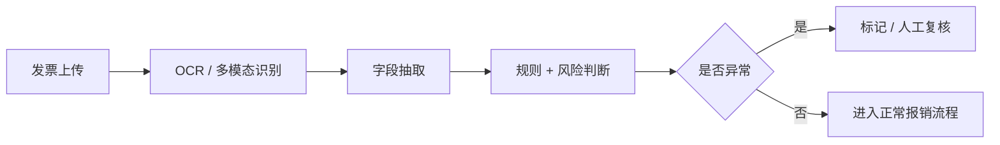
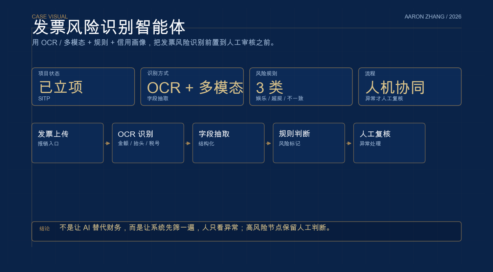

[← 返回主页](../README.md)

# 发票风险识别智能体

> 基于「信用画像 + AI 智能体」的报销流程优化方案，用 OCR 与多模态识别异常发票，防范财务造假。

<table>
<tr>
<td><strong>项目</strong></td>
<td>SITP 创新创业项目 · 已立项</td>
</tr>
<tr>
<td><strong>时间</strong></td>
<td>2025.12 – 至今</td>
</tr>
<tr>
<td><strong>角色</strong></td>
<td>核心组员 · 方案设计与智能体搭建</td>
</tr>
<tr>
<td><strong>关键词</strong></td>
<td><code>Coze</code> <code>OCR</code> <code>多模态</code> <code>风险识别</code></td>
</tr>
</table>

## 背景 / Context

高校财务报销存在两类痛点：

1. **人工审核成本高**：发票数量多、类型杂，财务老师需要逐张核对。
2. **异常识别依赖经验**：娱乐场所关联、金额超规、抬头/税号异常等问题，靠人眼容易漏。

项目希望在不改变现有报销流程的前提下，用「信用画像 + AI 智能体」把风险识别前置。

## 我的工作 / What I did

- 参与设计「信用画像 + AI 智能体」的报销流程优化方案。
- 基于 **Coze** 及同济 Agent 平台搭建发票识别智能体。
- 引入 **OCR 与多模态能力**，提取发票关键字段（金额、抬头、税号、消费类型等）。
- 设计异常识别规则，覆盖：
  - 娱乐场所关联
  - 金额超规
  - 发票信息不一致 / 异常
- 完成智能体的全流程调试与迭代，验证「上传 → 识别 → 风险判断 → 人工复核」的可行性。

## 结果 / Impact

- 项目已 **立项**，完成发票识别智能体的搭建与流程验证。
- 把「财务逐张看」变成「系统先筛一遍，人只看异常」，为后续扩大试点打基础。
- 方案同时考虑信用画像，尝试把「单张发票风险」扩展到「报销主体风险」。

## 关键数据 / Key Numbers

| 指标 | 数值 | 口径 |
|---|---|---|
| 项目状态 | 已立项 | SITP 创新创业项目 |
| 识别方式 | OCR + 多模态 | 发票字段抽取 |
| 风险规则 | 3 类 | 娱乐场所 / 金额超规 / 信息不一致 |
| 流程 | 人机协同 | 系统先筛，人工只看异常 |

图：上传、OCR/多模态识别、字段抽取、规则判断与人工复核的流程。

## 结论 / Takeaways

- **AI 放在“筛选”而不是“终审”**：高风险节点保留人工判断，既降低审核量，也避免模型误伤正常报销。
- **规则和模型各做一段**：OCR 负责“读出来”，规则负责“判断异常”，信用画像负责把单张发票风险扩展到报销主体风险。
- **原型阶段不承诺准确率**：项目完成流程验证，但没有大规模标注集和上线指标；这一点必须写清楚。

## 边界 / Limitations

- 目前处于项目立项与原型验证阶段，尚未大规模上线。
- 发票识别涉及敏感财务数据，案例不包含真实发票、金额或个人信息。
- 风险规则需要和财务老师共同校准，避免误伤正常报销。

## 可迁移的能力 / What it shows

- **流程设计**：先画清楚报销流程，再决定 AI 放在哪一步。
- **AI 落地判断**：不是所有环节都适合自动化，高风险节点保留人工复核。
- **规则 + 模型组合**：OCR 负责「读出来」，规则和模型负责「判断异常」。

---

> **说明**：该项目为课程 / 创新创业项目。以上仅展示方案思路和个人贡献，不包含真实发票、财务数据或系统截图。
