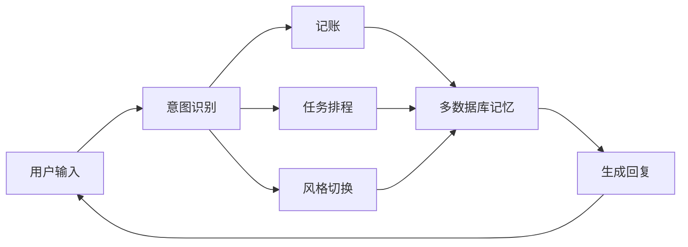
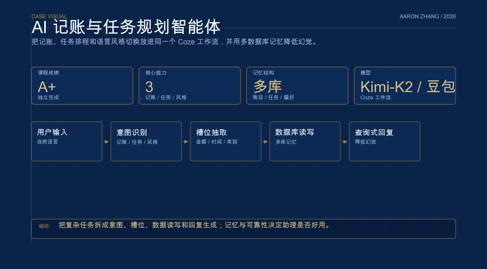

[← 返回主页](../README.md)

# AI 记账与任务规划智能体

> 独立搭建一个集记账、语言风格切换、任务排程于一体的 Coze 工作流智能体，课程设计成绩 A+。

<table>
<tr>
<td><strong>项目</strong></td>
<td>课程设计 · 独立完成</td>
</tr>
<tr>
<td><strong>时间</strong></td>
<td>2025.11 – 2025.12</td>
</tr>
<tr>
<td><strong>角色</strong></td>
<td>独立完成 · 工作流设计 / 搭建 / 调试</td>
</tr>
<tr>
<td><strong>关键词</strong></td>
<td><code>Coze</code> <code>Kimi-K2</code> <code>豆包 1.5 Pro</code> <code>多数据库记忆</code></td>
</tr>
</table>

## 背景 / Context

日常记账和任务管理通常是两个割裂的工具：记账 App 不管任务，任务工具不管消费。把两者放进一个对话式智能体，可以同时处理「今天花了什么」和「今天要做什么」。

但 LLM 做个人助理有两个典型问题：

- **记不住**：多轮对话后忘记之前的账目和任务。
- **会瞎编**：没有可靠的数据存储时，模型容易编造金额或待办。

## 我的工作 / What I did

我基于 **Coze 平台**（Kimi-K2、豆包 1.5 Pro）独立搭建了一个复杂工作流智能体：

1. **记账**：识别用户的消费描述，抽取金额、类别、时间、备注，写入账目。
2. **任务排程**：识别待办事项，支持按时间 / 优先级整理任务。
3. **语言风格切换**：同一件事可以用不同语气表达，测试模型的角色一致性。
4. **多重数据库记忆**：用多个数据库分别存储账目、任务、偏好，减少上下文遗忘。
5. **降低幻觉**：让模型基于数据库查询结果回答，而不是凭记忆生成。
6. **全流程调试**：从意图识别、槽位抽取到数据库读写，逐段测试和迭代。

## 结果 / Impact

- 完成一个可运行的复杂工作流智能体，课程设计成绩 **A+**。
- 把「记账 + 任务 + 风格切换」三个能力放进同一个对话入口。
- 通过多数据库记忆和查询式回答，降低模型幻觉。

## 关键数据 / Key Numbers

| 指标 | 数值 | 口径 |
|---|---|---|
| 课程成绩 | A+ | 课程设计 |
| 核心能力 | 3 类 | 记账 / 任务排程 / 风格切换 |
| 记忆结构 | 多数据库 | 账目 / 任务 / 偏好 |
| 模型 | Kimi-K2、豆包 1.5 Pro | Coze 工作流 |

图：用户输入、意图识别、槽位抽取、多库记忆与查询式回复的工作流。

## 结论 / Takeaways

- **复杂任务要拆成可测试的节点**：意图识别、槽位抽取、数据库读写、回复生成，每一段都可以单独调试。
- **记忆是助理产品的核心**：没有可靠的账目/任务存储，模型就会“看起来会”，但实际记不住、答不准。
- **查询式回答降低幻觉**：先查数据库再生成，比让模型凭上下文回忆更可靠。

## 可迁移的能力 / What it shows

- **工作流拆解**：把复杂任务拆成意图识别、槽位抽取、数据读写、回复生成。
- **AI 产品思维**：记忆、可靠性、风格一致性，决定助理「好不好用」。
- **独立交付**：从设计、搭建到调试，一个人把原型跑通。

---

> **说明**：该项目为课程设计。以上仅展示方案思路和个人贡献，不包含账号信息或完整提示词。
