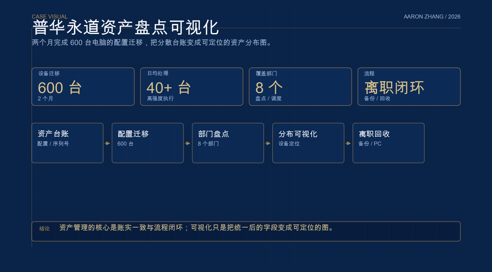

[← 返回主页](../README.md)

# 普华永道资产盘点可视化

> 两个月完成 600 台电脑的配置与数据迁移，把分散的资产台账变成带序列号的分布图。

<table>
<tr>
<td><strong>公司</strong></td>
<td>普华永道中天会计师事务所</td>
</tr>
<tr>
<td><strong>时间</strong></td>
<td>2025.10 – 2025.11</td>
</tr>
<tr>
<td><strong>角色</strong></td>
<td>FCS-GTS 部门 · 资产数据管理与可视化</td>
</tr>
<tr>
<td><strong>关键词</strong></td>
<td><code>资产管理</code> <code>数据可视化</code> <code>流程设计</code> <code>Agent 测试</code></td>
</tr>
</table>

## 背景 / Context

IT 资产管理的难点不在「记账」，而在「账实一致」：

- 电脑分布在多个部门，配置、序列号、使用人信息分散。
- 员工离职时，数据备份和 PC 回收容易遗漏。
- 资产盘点靠人工逐台核对，耗时且容易出错。

## 我的工作 / What I did

### 1. 资产台账数据管理

- 负责资产台账数据的采集与维护。
- 两个月累计完成 **600 台电脑**的配置与数据迁移，日均 **40+ 台**。
- 建立离职员工数据备份与 PC 回收流程，保障资产数据完整。

### 2. 资产盘点与可视化

- 协助覆盖 **8 个主要部门**的资产盘点与调度，日均盘点数十台设备。
- 绘制带序列号的资产分布图，把分散的台账数据转化为可视化看板。
- 让「某台设备在哪、归谁、状态如何」可以被快速定位。

### 3. Agent 智能体测试

- 参与部门 Agent 智能体的测试，记录问题并反馈。

## 结果 / Impact

- 两个月完成 **600 台**电脑配置与迁移，日均 **40+ 台**。
- 覆盖 **8 个部门**的资产盘点与调度。
- 建立离职数据备份与 PC 回收流程，减少资产遗漏。
- 资产分布可视化，提升盘点与调度效率。

## 关键数据 / Key Numbers

| 指标 | 数值 | 口径 |
|---|---|---|
| 设备迁移 | 600 台 | 两个月 |
| 日均处理 | 40+ 台 | 配置与数据迁移 |
| 覆盖部门 | 8 个 | 资产盘点与调度 |
| 流程 | 离职闭环 | 数据备份 + PC 回收 |

图：资产台账、配置迁移、部门盘点、分布可视化与离职回收的闭环。

## 结论 / Takeaways

- **资产管理的核心是账实一致**：可视化之前，必须先统一配置、序列号、使用人和状态字段。
- **流程闭环比一次性盘点重要**：离职备份与 PC 回收是资产最容易漏掉的环节。
- **高强度执行也需要方法**：600 台、日均 40+ 台，靠的是批次、清单和异常记录，而不是单纯加班。

## 可迁移的能力 / What it shows

- **流程意识**：资产管理的核心是流程闭环，不是一次性盘点。
- **数据可视化**：把台账变成图，前提是先把字段和口径统一。
- **高强度执行**：在固定时间窗口内完成大量重复但容错率低的工作。

---

> **说明**：该项目为实习期间内部项目。以上仅展示问题拆解、方法和个人贡献，不包含客户数据、系统截图或源代码；部分细节已做脱敏和概括处理。
