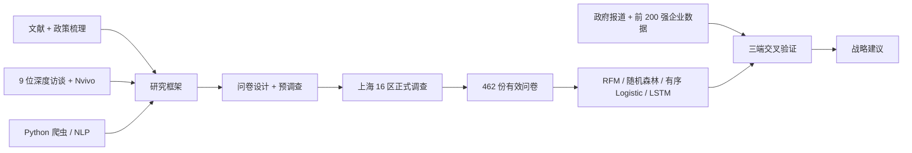
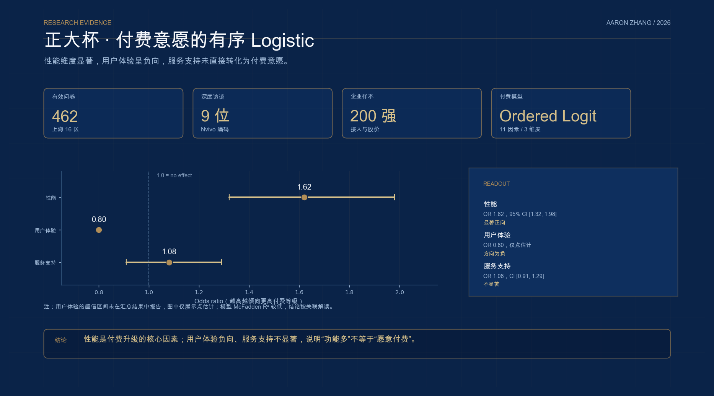
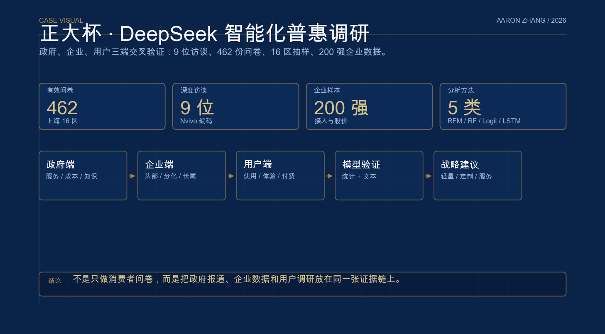

[← 返回主页](../README.md)

# 正大杯 · DeepSeek 智能化普惠调研

> 462 份有效问卷、9 位深度访谈、Python 爬虫 / NLP、RFM、随机森林、有序 Logistic、LSTM 情感分析，从政府、企业、用户三个层面研究 DeepSeek 的智能化普惠。

<table>
<tr>
<td><strong>项目</strong></td>
<td>第十五届「正大杯」全国大学生市场调查与分析大赛 · 全国三等奖</td>
</tr>
<tr>
<td><strong>时间</strong></td>
<td>2024.12 – 2025.06</td>
</tr>
<tr>
<td><strong>角色</strong></td>
<td>核心组员 · 全程参与研究设计、数据采集、建模与报告撰写</td>
</tr>
<tr>
<td><strong>关键词</strong></td>
<td><code>Python</code> <code>Nvivo</code> <code>RFM</code> <code>RandomForest</code> <code>Ordered Logistic</code> <code>LSTM</code></td>
</tr>
</table>

## 研究问题 / Research Question

研究主题是「AI 崛起效应下 DeepSeek 智能化普惠」。核心问题不是「DeepSeek 好不好用」，而是：

- **政府端**：DeepSeek 接入政务后，是否真的带来服务、成本和知识层面的普惠？
- **企业端**：前 200 强企业如何接入？行业分布和资本市场表现有什么变化？
- **用户端**：哪些因素影响使用、偏好、体验和付费意愿？
- 技术崛起如何真正转化为社会福祉？

## 研究设计 / Design

采用「定性聚焦 → 定量验证 → 综合施策」的递进框架，线上与线下结合：

- **线上**：文献综述、Python 爬虫（小红书 / 微博）、线上访谈、LSTM 情感分析。
- **线下**：街采、预调查、正式调查、补充调查。
- **抽样**：上海 16 区，分层抽样 + 实地拦截；预调查和正式调查均做信度 / 效度检验。
- **样本**：9 位深度访谈对象；回收 **462 份有效问卷**。

## 数据与质量控制 / Data

- 深度访谈覆盖算法专家、消费者等不同背景，用 Nvivo 做质性编码。
- 爬取小红书、微博的 DeepSeek 相关内容，做清洗、去噪、词频和情感分析。
- 问卷覆盖使用行为、偏好、体验感知、支付意愿四个模块。
- 预调查与正式调查分别做 **Cronbach's α** 和 **KMO / Bartlett** 检验，保证量表信度与结构效度。
- 上海 16 区按人口和区域特征做分层抽样，减少样本偏置。

## 模型 / Models

### 1. 用户分层：RFM + 随机森林

用 RFM 聚类把用户分成不同价值/活跃度群体，再用随机森林识别影响用户分层的关键因素，并针对学生、技术人员、管理人员、自由职业者分别给出运营建议。

### 2. 偏好识别：有序 Logistic

把 11 个偏好因素归为三个维度：性能、用户体验、服务支持与技术。因变量是用户愿意付费的等级（0–4）。

| 变量 | OR | 95% CI | 解释 |
|---|---:|---|---|
| 性能 | **1.62** | [1.32, 1.98] | 性能每提升 1 单位，更高付费等级的概率显著增加 |
| 用户体验 | 0.80 | — | 呈负向，可能与期望过高、隐私顾虑、非线性关系有关 |
| 服务支持与技术 | 1.08 | [0.91, 1.29] | 不显著，未直接转化为付费意愿 |

> 模型 McFadden R² 较低（约 0.004），因此更适合解读为「关联」而不是强预测；Brant 检验与 VIF 用于检查比例优势假设和共线性。

### 3. 体验感知：LSTM + 词云

用 LSTM 对微博 / 小红书文本做情感分类，再分词频和词云：

- 正面情感集中在技术创新、智能化服务、对新手友好。
- 负面情感集中在技术复杂性、不稳定性、学术场景下的操作困难。

### 4. 支付意愿

- 受访者的付费额度主要集中在 **(0, 50] 元** 区间；500 元以上的技术人员占比很低。
- 在按月订阅假设下，约 **50%** 愿意支付 30 元以上/月，约 **30%** 愿意支付 50 元以上/月。
- 对国产 AI 的支持度约为 **75:25**，但「愿意支持」到「愿意支付溢价」之间有明显衰减。
- 高收入人群的溢价支付意愿更高；支持国产、常用国产 AI 的用户支付意愿更高。

## 关键图表 / Evidence

图：性能维度 OR=1.62（95% CI [1.32, 1.98]）；用户体验 OR=0.80（仅点估计）；服务支持 OR=1.08（CI [0.91, 1.29]，不显著）。

图：三端证据链——政府报道与政策、前 200 强企业接入与股价、462 份用户问卷与 9 位访谈。

## 三端发现 / Findings

### 政府端

DeepSeek 在政务领域体现三类普惠价值：

- **服务普惠**：提升办事效率和回应速度。
- **成本普惠**：降低部署和调用成本。
- **知识普惠**：让政策和公共服务信息更易被理解。

### 企业端

- 前 200 强企业接入呈现 **头部效应、行业分化、长尾潜力**。
- 接入 DeepSeek 后，企业股价整体有正向反应，但行业间差异明显。
- 不同行业的主营业务接入方式不同，不能用一个模板复制。

### 用户端

- 形成「社交媒体主力引流 + 新闻媒体权威扩散 + 亲友口碑信任增强」的复合传播模式。
- 性能是付费升级的核心因素，用户体验的影响更复杂，服务支持需要转化成可感知的价值。
- 前期质性/文本分析中，**流式输出、需求理解力、响应速度** 是用户反复提到的关注点。

## 战略建议 / Recommendations

1. **轻量化模块协同**：面向县域/中小城市算力有限场景，提供低参数版本、模块化部署和「AI 即服务」订阅。
2. **定制化生态扩张**：头部企业共建行业级 AI 底座，中小企业用轻量工具包，激活长尾市场。
3. **差异化服务支持**：把技术支持、隐私安全、个性化能力转成用户能感知的价值，而不是只堆功能。

## 成果 / Impact

- **全国三等奖**：995 所高校、28 万+ 人报名，省赛超 1 万支队伍。
- 形成 60 页研究报告、答辩 PPT、问卷与数据附录。
- 把政府报道、企业数据、用户问卷三条线汇成一套完整的三端分析，而不是只做消费者问卷。
- 个人贡献：全程参与研究设计、访谈与质性分析、爬虫/文本处理、问卷数据清洗、建模和报告撰写。

## 结论 / Takeaways

- **性能是付费升级的核心因素**：OR=1.62，95% CI [1.32, 1.98]；用户体验 OR=0.80，方向为负；服务支持 OR=1.08，不显著——“功能多”不等于“愿意付费”。
- **三端证据互相印证**：政府端看到服务/成本/知识普惠，企业端看到头部效应、行业分化和长尾潜力，用户端看到“社交引流 + 新闻权威 + 亲友口碑”的传播结构。
- **支付意愿存在“支持但不溢价”的断层**：约 75:25 支持国产 AI，但付费额度主要集中在 (0, 50] 元；约 50% 愿意 30 元以上/月，约 30% 愿意 50 元以上/月。
- **策略要分层**：轻量化模块协同、定制化生态扩张、差异化服务支持，分别对应县域/中小企业、头部企业和用户感知价值。

## 边界 / Limitations

- 样本主要来自上海，外部效度有限。
- 支付意愿是自报告，和真实付费行为可能有差距。
- 有序 Logistic 的解释力有限，结论应表述为关联而非因果。
- 企业股价受市场、行业、宏观因素影响，不能全部归因于接入 DeepSeek。
- 质性编码和 FMEA/文本分类包含人工判断，存在主观性。

## 这个项目说明了什么 / What it shows

- **混合研究方法**：访谈 + 爬虫 + 问卷 + 统计建模 + 情感分析。
- **三端视角**：政府、企业、用户，而不是只看消费者。
- **模型边界**：知道 R² 低、自报告偏差、股价归因风险，并主动写清楚。
- **研究与表达**：把复杂结论压缩成可汇报、可落地的建议。

---

> **说明**：案例页只展示研究方法和公开结论，不包含原始问卷、访谈录音或未公开数据。
