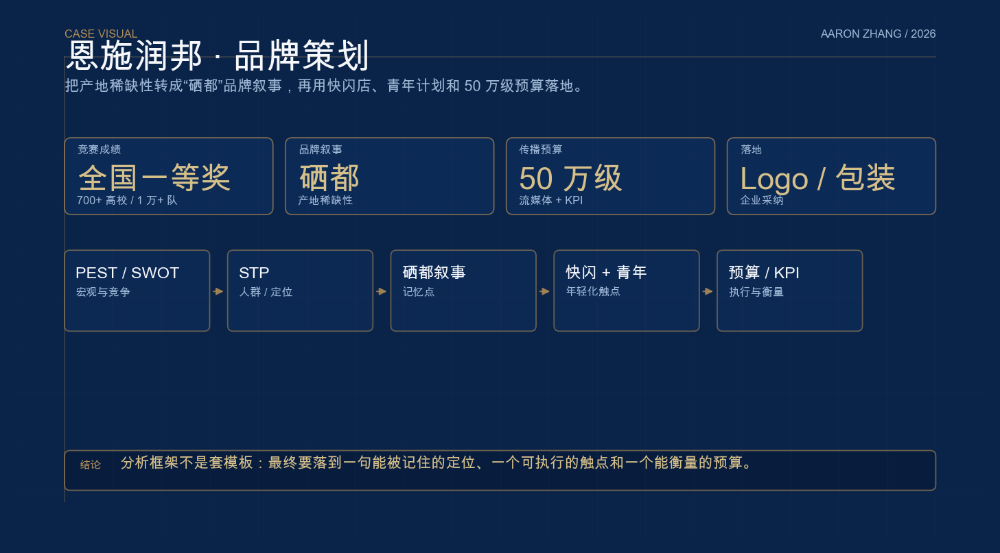

[← 返回主页](../README.md)

# 品牌策划赛 · 恩施润邦茶业

> 用 PEST / SWOT / 波特五力 / STP 做竞争分析，提出「硒都」品牌叙事，最终获全国一等奖，方案被企业采纳。

<table>
<tr>
<td><strong>项目</strong></td>
<td>全国高校商业精英挑战赛 · 品牌策划赛 · 全国一等奖</td>
</tr>
<tr>
<td><strong>时间</strong></td>
<td>2025.01 – 2025.08</td>
</tr>
<tr>
<td><strong>角色</strong></td>
<td>核心组员 · 调研 / 品牌定位 / 传播策划</td>
</tr>
<tr>
<td><strong>关键词</strong></td>
<td><code>PEST</code> <code>SWOT</code> <code>STP</code> <code>品牌叙事</code></td>
</tr>
</table>

## 背景 / Context

恩施润邦茶业有不错的产地资源，但品牌辨识度不强，年轻消费者对「恩施硒茶」的认知有限。

团队要回答三个问题：

1. 恩施茶的核心差异点是什么？
2. 应该面向谁讲这个故事？
3. 用什么内容、渠道和预算，把故事讲出去？

## 我的工作 / What I did

- **实地调研**：前往恩施润邦茶业，对接企业负责人，了解产品、渠道和品牌现状。
- **竞争分析**：运用 PEST、SWOT、波特五力、CAMP-S 完成竞争分析与 STP 品牌定位。
- **品牌叙事**：创新提出 **「硒都」** 品牌叙事，把产地稀缺性转成消费者能听懂的记忆点。
- **年轻化策划**：策划「茶叶快闪店」「硒力青年计划」，拓展 Z 世代受众。
- **传播预算**：制定 **50 万元级**流媒体宣传预算与 KPI 体系。
- **落地跟进**：新品牌 Logo 与包装设计方案被企业实际采纳落地。

## 结果 / Impact

- **全国一等奖**：全国 700 余所高校、1 万余支队伍参赛。
- 新品牌 Logo 与包装设计方案被企业实际采纳落地。
- 把「产地优势」转成「品牌叙事 + 年轻化触点 + 可执行预算」的完整方案。

## 关键数据 / Key Numbers

| 指标 | 数值 | 口径 |
|---|---|---|
| 竞赛成绩 | 全国一等奖 | 全国高校商业精英挑战赛 · 品牌策划赛 |
| 参赛规模 | 700+ 高校 / 1 万+ 队伍 | 公开赛事口径 |
| 传播预算 | 50 万元级 | 流媒体宣传 + KPI |
| 落地 | Logo / 包装方案 | 企业实际采纳 |

图：从 PEST/SWOT、STP、硒都叙事、快闪/青年计划到预算与 KPI 的策略链路。

## 结论 / Takeaways

- **产地优势不会自动变成品牌**：要把“恩施硒茶”翻译成消费者能记住的“硒都”叙事，才形成差异点。
- **定位之后要有触点**：快闪店和“硒力青年计划”把品牌从一句口号变成可体验的内容。
- **方案要能落地**：50 万级预算、KPI 和 Logo/包装落地，比只讲品牌理念更能证明策略有效。

## 可迁移的能力 / What it shows

- **从调研到策略**：分析框架不是套模板，最终要落到定位和行动。
- **品牌叙事**：把专业术语翻译成消费者语言。
- **落地意识**：方案不只停在 PPT，Logo 和包装真正被企业采用。

---

> **说明**：该项目为学科竞赛。以上仅展示公开的比赛结果和方法，不包含企业未公开的经营数据。
