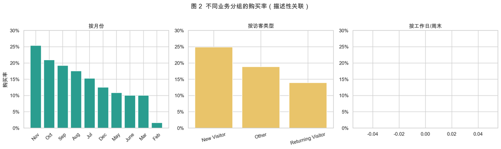
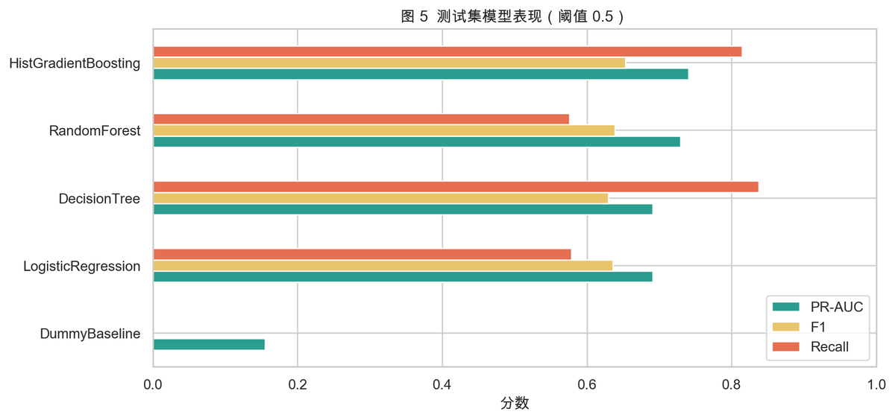
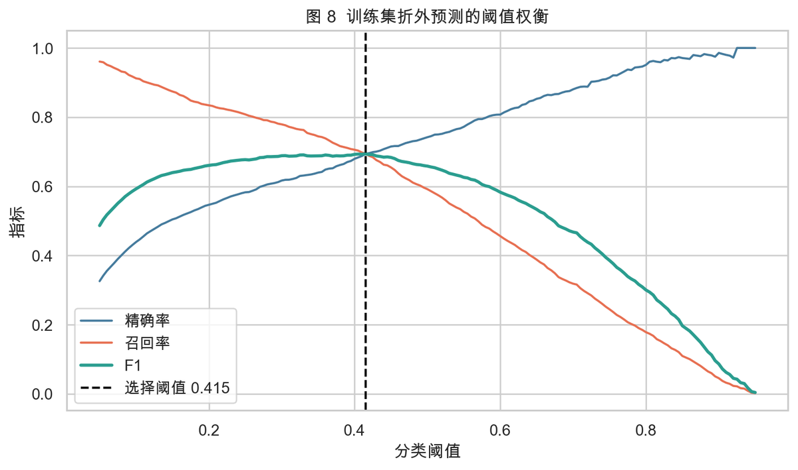
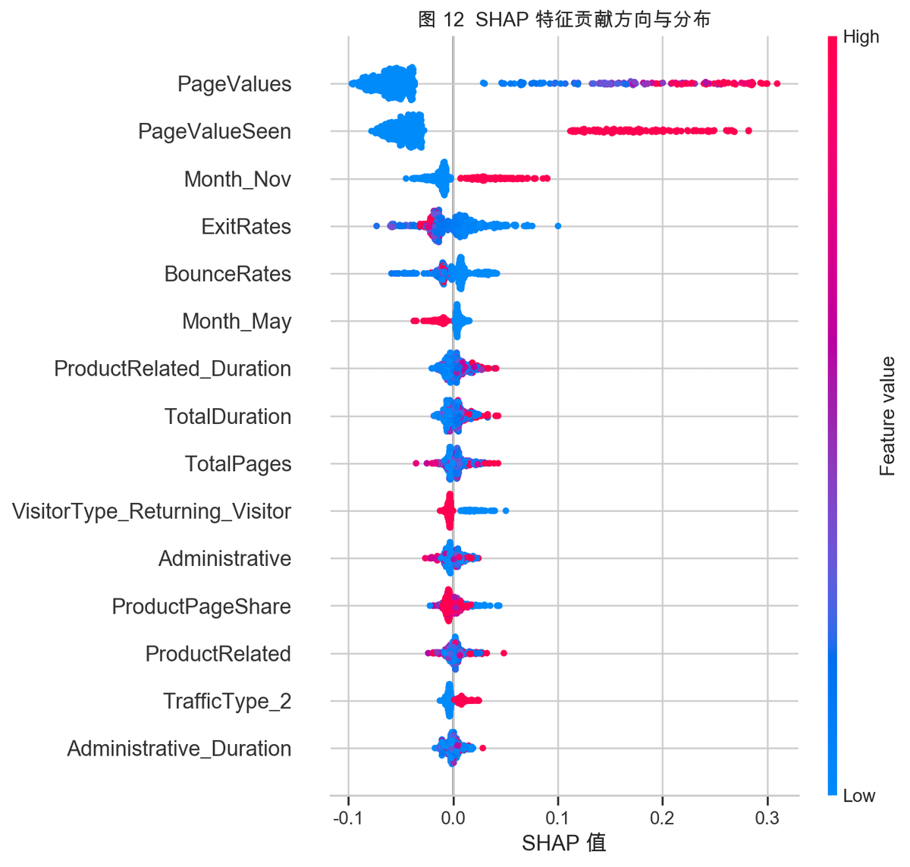
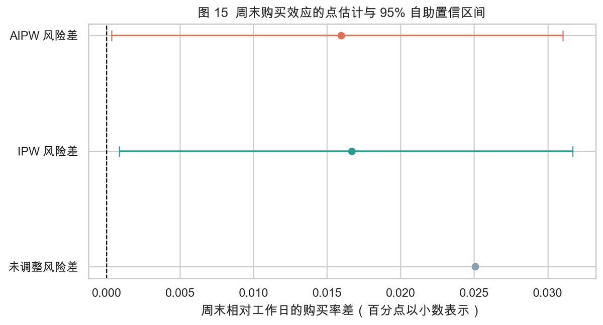

[← 返回主页](../README.md)

# 电商会话购买意图预测

> 12,330 条会话、15.47% 购买率；用可解释机器学习和倾向得分因果分析，回答「哪些会话会买」以及「周末是否真的提高购买率」。

<table>
<tr>
<td><strong>项目</strong></td>
<td>个人项目 · 独立完成</td>
</tr>
<tr>
<td><strong>时间</strong></td>
<td>2026.11</td>
</tr>
<tr>
<td><strong>方向</strong></td>
<td>商业分析 / 可解释机器学习 / 因果推断</td>
</tr>
<tr>
<td><strong>关键词</strong></td>
<td><code>Python</code> <code>scikit-learn</code> <code>SHAP</code> <code>IPW / AIPW</code> <code>PR-AUC</code></td>
</tr>
</table>

## 问题定义 / Problem

电商平台每天产生大量会话。如果能在会话早期识别高购买概率访问，就可以把优惠券、客服和再营销资源投向更可能转化的人群，同时减少对低意向用户的打扰。

项目刻意区分两个问题：

1. **预测问题**：根据会话特征预测 `Revenue=1`（完成购买）的概率。
2. **因果问题**：在观察数据和明确识别假设下，估计「周末访问」相对「工作日访问」对购买率的平均影响。

预测模型回答「哪些会话更像会买」；因果分析回答「周末是否真的改变了购买率」。两者使用不同方法、不同假设和不同结论语言。

## 数据 / Data

使用 UCI **Online Shoppers Purchasing Intention Dataset**：

- 12,330 条匿名会话，17 个输入字段，1 个目标字段。
- 购买会话 1,908 条，购买率 **15.47%**。
- 覆盖行政页、信息页、商品页、停留时长、跳出率、退出率、PageValues、月份、设备/地区/渠道、访客类型和周末标记。
- 数据没有缺失值，存在 125 行完全重复；没有业务证据证明它们是错误记录，主分析保留，避免为了「干净」误删真实少数类。

图：不同业务分组的购买率差异；用于判断是否需要分群建模。

> 描述性差异不等于因果效应。月份、访客类型和周末的购买率差异，可能由渠道、月份和用户构成等混杂导致。

## 分析设计 / Design

### 防止数据泄漏

- 目标变量 `Revenue` 从不参与特征工程。
- 按目标比例分层划分 80% 训练集 / 20% 测试集。
- 预处理、超参数选择和分类阈值全部在训练集内部完成。
- 测试集只用于最终报告，不参与模型选择。

### 特征工程

构造五个可解释的会话级特征：

- `TotalPages`：浏览广度
- `TotalDuration`：投入总量
- `AvgSecondsPerPage`：单页关注度
- `ProductPageShare`：商品探索集中度
- `PageValueSeen`：是否接触有估计价值的页面

### 模型与评估

- 候选模型：多数类基准、逻辑回归、决策树、随机森林、HistGradientBoosting。
- 五折分层交叉验证，以 **PR-AUC** 调参；ROC-AUC 作为概率排序能力的补充。
- 阈值不使用 0.5，也不使用测试标签：用训练集折外预测选择 F1 最优阈值 **0.415**。

## 关键数据 / Key Numbers

| 指标 | 数值 | 说明 |
|---|---:|---|
| 会话数 | 12,330 | UCI Online Shoppers Purchasing Intention |
| 购买率 | 15.47% | 类别不平衡 |
| 特征数 | 19 | 数值 + 类别 |
| 划分 | 80/20 分层 | 五折 CV 调参 |
| PR-AUC | 0.7290 | 测试集，正类 |
| ROC-AUC | 0.9199 | 测试集 |
| 阈值 | 0.415 | 训练集折外 F1 最大 |
| Precision / Recall / F1 | 0.6606 / 0.6623 / 0.6614 | 测试集 |
| AIPW 周末效应 | +1.59pp | 95% CI [+0.03, +3.10] |

## 结果 / Results

按训练集五折 CV 的 PR-AUC 选择 **RandomForest**。测试集只做最终评估：

| 指标 | 结果 |
|---|---:|
| PR-AUC | **0.7290** |
| ROC-AUC | **0.9199** |
| Precision（阈值 0.415） | 0.6606 |
| Recall（阈值 0.415） | 0.6623 |
| F1（阈值 0.415） | 0.6614 |

> 测试集上 HistGradientBoosting 的 PR-AUC 为 0.7408，略高于 RandomForest；但没有用测试集反选模型，避免评估泄漏。模型选择只依据训练集交叉验证。

图：测试集 ROC / PR 曲线与关键指标；PR-AUC 更适合类别不平衡。

图：阈值—precision/recall/F1 的权衡；0.415 为训练集折外 F1 最大点。

## 可解释性 / Interpretation

用置换重要性、逻辑回归系数和 SHAP 解释模型。按置换重要性，前 8 个字段是：

**PageValues, PageValueSeen, Month, Administrative_Duration, ExitRates, ProductPageShare, VisitorType, ProductRelated_Duration**

正确的表述是「当前模型依赖这些信息进行预测」，而不是「提高这些字段就会直接提高购买率」。

图：SHAP 特征贡献；PageValues、月份、访问页数等是主要驱动。

## 因果分析 / Causal

以 `Weekend` 为处理变量、`Revenue` 为结局，只调整访问前/身份/渠道变量，不调整访问后的浏览行为和 PageValues。

识别依赖四个假设：

- **一致性**：观察到的周末结果对应「如果该会话在周末发生」的潜在结果。
- **条件可交换性**：调整已测量协变量后，周末/工作日分配不再与潜在结果相关。
- **正性**：在协变量相同或相近的会话中，两种访问日都有非零出现概率。
- **SUTVA**：一个会话的潜在结果不受其他会话影响。

| 方法 | 风险差 | 95% 置信区间 |
|---|---:|---|
| 未调整风险差 | +2.51 个百分点 | 未计算 |
| IPW 风险差 | +1.67 个百分点 | [+0.09%, +3.17%] |
| AIPW 风险差 | **+1.59 个百分点** | **[+0.03%, +3.10%]** |

在当前的因果图、可观测协变量和识别假设下，周末访问平均提高购买率 **1.59 个百分点**。该结论仍受未测量混杂限制，不能直接等同于「把流量挪到周末就能提升 1.59%」。

图：AIPW 周末效应 +1.59pp，95% CI [+0.03, +3.10]；下界接近 0。

## 稳健性与边界 / Robustness & Limits

### PageValues 稳健性

`PageValues` 与交易关联很强，可能包含接近结果的信息。保持模型类型和超参数不变，移除 `PageValues` 及派生指示变量后：

| 场景 | PR-AUC | ROC-AUC |
|---|---:|---:|
| 包含 PageValues | 0.7290 | 0.9199 |
| 移除 PageValues | 0.3563 | 0.7614 |

这不是「删除变量的因果实验」，而是判断模型是否过度依赖一个上线时可能拿不到的字段。实际部署应使用移除后的结果作为更接近真实场景的参考。

### 为什么不用 LSTM

原数据每行是一次独立会话，没有真实时间戳，也没有同一用户的连续事件序列。强行把相邻行拼成序列，会把不存在的时间关系输入模型，违反数据生成机制。要真正做序列建模，需要先取得事件级时间和用户会话序列。

### 其他限制

- 数据只覆盖一个网站一年，外部效度有限。
- 因果分析仍可能受价格、广告、库存、设备体验等未测量混杂影响。
- 阈值按 F1 选择；真实业务应按营销成本、客单价和资源约束重新优化。
- 预测模型不等于因果模型，SHAP 也不等于因果解释。

## 结论 / Takeaways

- **预测与因果要分开**：PR-AUC/ROC 回答“哪些会话更可能购买”，AIPW 回答“周末是否提高购买率”；两者不能互相替代。
- **阈值要业务化**：0.415 是训练集折外 F1 最大点，不是唯一正确阈值；如果运营只想筛少量高意向会话，应换更高阈值并重新评估 precision/recall。
- **PageValues 是强特征但不能神化**：移除后 PR-AUC 0.3563、ROC-AUC 0.7614，性能下降但仍高于随机；它可能承载“用户已表现出高意向”的代理信息。
- **AIPW 的结论有边界**：+1.59pp 的 95% CI 下界接近 0，说明周末效应存在但不算强；观察数据仍可能有未测量混杂。

## 这个项目说明了什么 / What it shows

- **业务问题定义**：把「识别高意向用户」和「周末是否有效」拆成预测与因果两个不同问题。
- **评价指标选择**：在 15.47% 的不平衡数据里，不用虚高的准确率，而用 PR-AUC、F1、召回率和阈值权衡。
- **研究严谨性**：分层划分、Pipeline、折外阈值、测试集隔离、稳健性检查。
- **因果边界**：明确写出识别假设，区分模型解释与因果效应。
- **沟通能力**：把模型结果翻译成业务可用的结论，同时说清楚不能证明什么。

## 代码与材料 / Code

- [运行说明与项目结构](./modeling/README.md)
- [分析代码](./modeling/code/analysis.py)
- [核心结果 JSON](./modeling/results/final_summary.json)
- [数据来源说明](./modeling/data/README.md)

> 原始数据不随仓库分发，请从 UCI 官方页面下载。数据许可 CC BY 4.0。
