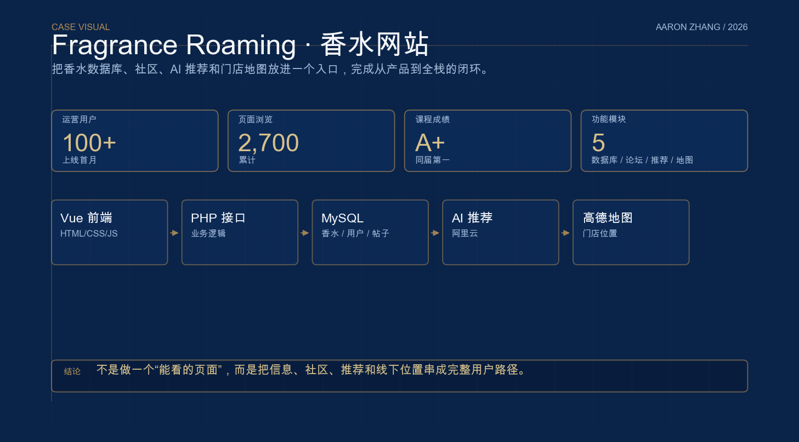

[← 返回主页](../README.md)

# Fragrance Roaming · 一站式香水网站

> 从香水数据库、社区论坛到 AI 推荐与门店地图，独立负责一个完整网站的产品设计与全栈实现。

<table>
<tr>
<td><strong>项目</strong></td>
<td>课程项目 · 团队负责人</td>
</tr>
<tr>
<td><strong>时间</strong></td>
<td>2025.07 – 2025.08</td>
</tr>
<tr>
<td><strong>角色</strong></td>
<td>产品设计 / 前端 / 后端 / 数据库</td>
</tr>
<tr>
<td><strong>关键词</strong></td>
<td><code>Vue</code> <code>PHP</code> <code>MySQL</code> <code>Bootstrap</code> <code>AJAX</code></td>
</tr>
</table>

## 背景 / Context

香水爱好者的信息分散在电商详情页、社区帖子和线下门店里：新手不知道怎么选，进阶用户想查香调、品牌和相似香，专业用户又缺少一个可以讨论和沉淀内容的社区。

项目目标是做一个「从入门到进阶」的一站式香水网站，把**香水数据库、社区论坛、个性化推荐和门店位置**放在同一个入口里。

## 我的工作 / What I did

- 设计并整合香水信息数据库与论坛模块，覆盖从新手到专业用户的不同需求。
- 集成阿里云 AI 大模型，实现个性化香水推荐。
- 集成高德地图 API，支持香水品牌门店位置查询。
- 使用 HTML、CSS、JavaScript 实现前端，结合 Bootstrap、AJAX 和 Vue 提升交互与开发效率。
- 使用 MySQL + Navicat 设计后端数据库，通过 PHP 连接前后端。
- 负责团队分工、进度推进和最终答辩。

## 结果 / Impact

- 网站上线运营一个月，服务 **100+ 用户**，累计 **2,700 页面浏览**。
- 课程项目获 **A+**，在同届中排名第一。
- 完成从需求、数据库、前后端到第三方 API 集成的完整闭环。

## 关键数据 / Key Numbers

| 指标 | 数值 | 口径 |
|---|---|---|
| 运营用户 | 100+ | 上线首月 |
| 页面浏览 | 2,700 | 累计 |
| 课程成绩 | A+ / 同届第一 | 课程项目 |
| 功能模块 | 5 类 | 数据库 / 论坛 / AI 推荐 / 地图 / 后台 |

图：Vue 前端、PHP 接口、MySQL、阿里云 AI 推荐与高德地图的完整链路。

## 结论 / Takeaways

- **产品不是页面堆叠**：香水数据库、社区、推荐和门店地图要围绕“从入门到进阶”的用户路径组织。
- **全栈能力体现在接口边界**：前端交互、PHP 接口、MySQL 表结构和第三方 API 要一起设计。
- **真实用户数据比课程分数更有说服力**：首月 100+ 用户、2,700 浏览，说明原型至少被真实使用过。

## 可迁移的能力 / What it shows

- **产品思维**：不是做一个「能看的页面」，而是把信息、社区和推荐串成用户路径。
- **全栈落地**：前端交互、后端接口、数据库设计和第三方 API 集成。
- **从 0 到 1**：在短时间内把想法做成可运行、可被真实用户使用的产品。

---

> **说明**：该项目为课程项目，目前没有公开的线上 Demo；源代码和系统截图可在面试中展示。
