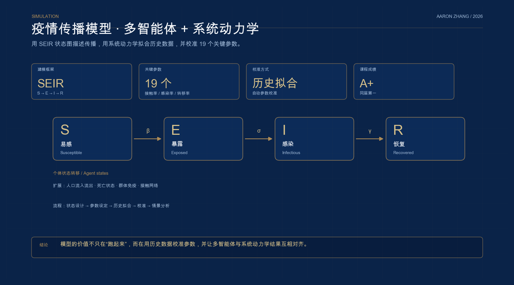

[← 返回主页](../README.md)

# 疫情传播模型拟合 · 多智能体 + 系统动力学

> 用 AnyLogic 搭建 SEIR 多智能体模型，并用系统动力学拟合历史数据、校准 19 个关键参数。

<table>
<tr>
<td><strong>项目</strong></td>
<td>课程项目 · 团队负责人</td>
</tr>
<tr>
<td><strong>时间</strong></td>
<td>2025.07 – 2025.08</td>
</tr>
<tr>
<td><strong>角色</strong></td>
<td>建模设计 / Java 实现 / 参数校准 / 结果分析</td>
</tr>
<tr>
<td><strong>关键词</strong></td>
<td><code>AnyLogic</code> <code>SEIR</code> <code>多智能体</code> <code>系统动力学</code> <code>Java</code></td>
</tr>
</table>

## 背景 / Context

后疫情背景下，如何用一个可解释的模型描述疾病传播过程，并为防控策略提供参考？

项目选择「多智能体 + 系统动力学」的组合：多智能体模拟个体状态和接触网络，系统动力学拟合总体传播趋势，两者互相校准。

## 我的工作 / What I did

- 基于 SEIR 状态图，用 AnyLogic 构建多智能体模型，模拟易感、暴露、感染、恢复四种个体状态。
- 通过动画和图表实时可视化传播动态。
- 设计并调整 **19 个关键参数**，包括接触率、感染率、人口转移率等。
- 用 Java 实现感染逻辑；用系统动力学模型拟合历史数据，并通过自动校准优化参数，使多智能体结果与系统动力学结果对齐。
- 扩展模型：加入人口流入/流出、死亡状态和群体免疫机制。
- 负责团队分工、模型整合和最终汇报。

## 结果 / Impact

- 完成可运行的多智能体 + 系统动力学耦合模型。
- 课程项目获 **A+**，在同届中排名第一。
- 形成一套可复用的建模流程：状态设计 → 参数设定 → 历史拟合 → 校准 → 情景分析。

## 关键数据 / Key Numbers

| 指标 | 数值 | 口径 |
|---|---|---|
| 建模框架 | SEIR 多智能体 + 系统动力学 | S → E → I → R |
| 关键参数 | 19 个 | 接触率、感染率、转移率等 |
| 校准方式 | 历史数据拟合 | 自动参数校准 |
| 课程成绩 | A+ / 同届第一 | 课程项目 |

图：S/E/I/R 状态转移与多智能体建模结构；参数通过历史数据拟合校准。

## 结论 / Takeaways

- **模型不是“跑起来”就结束**：要用历史数据校准参数，并检查多智能体与系统动力学结果是否对齐。
- **状态、参数、反馈回路**是建模的三件事：先定义状态，再设定参数，最后看个体行为与总体传播的反馈。
- **案例不伪造拟合曲线**：本页只展示模型结构和参数口径；具体拟合优度以课程模型文件为准。

## 可迁移的能力 / What it shows

- **建模思维**：把现实问题抽象成状态、参数和反馈回路。
- **参数校准**：模型不是「跑起来」就结束，还要用历史数据检验和调整。
- **系统视角**：个体行为与总体传播之间的反馈关系。

---

> **说明**：该项目为课程项目，模型文件可在面试中展示；案例页不包含完整模型文件和原始数据。
