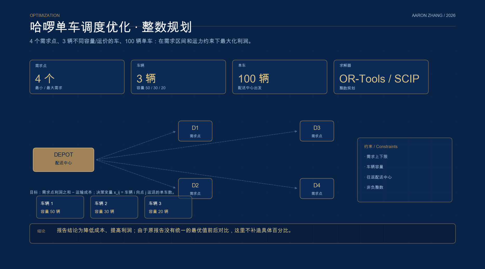

[← 返回主页](../README.md)

# 哈啰单车调度优化

> 用整数规划为哈啰出行设计上海市区的单车调度方案：4 个需求点、3 辆运输车、100 辆单车，在需求上下限和运力约束下优化运输成本与利润。

<table>
<tr>
<td><strong>项目</strong></td>
<td>运筹学课程案例 · 小组项目（全面参与）</td>
</tr>
<tr>
<td><strong>时间</strong></td>
<td>2024 秋</td>
</tr>
<tr>
<td><strong>方向</strong></td>
<td>运营优化 / 整数规划 / 路径调度</td>
</tr>
<tr>
<td><strong>关键词</strong></td>
<td><code>Python</code> <code>OR-Tools</code> <code>SCIP</code> <code>Integer Programming</code></td>
</tr>
</table>

## 问题 / Problem

哈啰出行在上海的部分区域存在明显的潮汐需求：有的点位单车积压，有的点位供给不足。案例设定一个配送中心（Depot）和 4 个需求点，由 3 辆运输车完成 100 辆单车的调度。

每辆车有不同容量和每公里运价，每个需求点有最小/最大需求量、距离和单车利润。目标是在满足需求区间和车辆容量的前提下，决定每辆车向每个点位运送多少单车、走什么路径，使**总利润最大、运输成本最小**。

## 模型 / Model

- 决策变量：车辆 `i` 向需求点 `j` 运送的单车数量 `x_ij`。
- 目标函数：各需求点利润之和 − 各车辆运输成本。
- 约束条件：
  - 每个需求点的供给量不低于最小需求、不高于最大需求；
  - 每辆车的配送量不超过其容量；
  - 车辆从配送中心出发并返回；
  - 运输量、车辆容量等为非负整数。
- 求解：用 Python 调用 **OR-Tools** 的线性求解器（SCIP）求解整数规划，并根据距离矩阵输出每辆车的路径与配送量。

## 结果 / Results

课程报告给出的结论是：通过合理分配 3 辆车的任务与路径，方案降低了运输成本，并提高了整体运营利润；同时避免了部分点位短缺、部分点位积压的情况。

> 报告以模型、代码和求解结果为主，没有做统一的最优值前后对比。这里不补造具体百分比。

## 关键数据 / Key Numbers

| 指标 | 数值 | 口径 |
|---|---|---|
| 需求点 | 4 个 | 最小/最大需求量 |
| 运输车 | 3 辆 | 容量 50 / 30 / 20 辆 |
| 单车 | 100 辆 | 配送中心出发 |
| 求解器 | OR-Tools / SCIP | 整数规划 |

图：配送中心、4 个需求点、3 辆不同容量车辆与约束条件；虚线为候选路径，不代表唯一最优解。

## 结论 / Takeaways

- **调度问题要同时看需求区间、容量、距离和利润**：只追求“送得最多”会忽略运输成本，只追求“成本最低”会牺牲需求满足。
- **整数规划把业务语言变成可计算模型**：决策变量、目标函数和约束条件必须一一对应业务规则。
- **不补造前后对比**：原报告没有统一的最优值对照，本页只给出模型口径和求解方式，不虚构百分比。

## 这个项目说明了什么 / What it shows

- **运筹建模**：把业务描述转成变量、目标函数和约束条件。
- **求解器使用**：用 OR-Tools/SCIP 处理整数规划，而不是只写伪代码。
- **运营视角**：调度不只是“把车派出去”，还要同时考虑需求区间、容量、距离和利润。

---

> **说明**：该项目为课程小组案例，案例页不包含完整代码和原始报告；需要时可在面试中展示。
