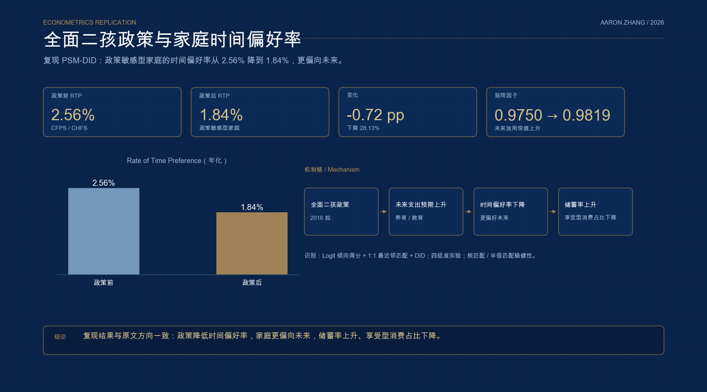

[← 返回主页](../README.md)

# 全面二孩政策与家庭储蓄—消费（复现）

> 基于 CFPS / CHFS 微观数据，复现「全面二孩政策 → 家庭时间偏好 → 储蓄—消费」的 PSM-DID 分析流程。

<table>
<tr>
<td><strong>项目</strong></td>
<td>计量经济学课程论文 · 小组复现作业（全面参与）</td>
</tr>
<tr>
<td><strong>时间</strong></td>
<td>2025 秋</td>
</tr>
<tr>
<td><strong>方向</strong></td>
<td>应用计量 / 政策评估 / 因果推断</td>
</tr>
<tr>
<td><strong>关键词</strong></td>
<td><code>Stata</code> <code>PSM-DID</code> <code>CFPS</code> <code>CHFS</code> <code>面板数据</code></td>
</tr>
</table>

## 背景 / Context

全面二孩政策会改变家庭的抚养压力、未来支出预期和跨期决策。项目关注的问题是：政策是否降低了政策敏感型家庭的时间偏好率，并进一步影响家庭的储蓄与消费结构。

这是一个**复现作业**：核心是复现论文的识别思路和 PSM-DID 流程，而不是提出一个全新的研究问题。

## 数据 / Data

- CFPS 2010–2020
- CHFS 2013–2019
- 核心变量：家庭总消费、家庭总收入、家庭规模、生育信息、资产与负债等。

数据清洗在 Stata 中完成：删除核心变量缺失样本；对连续经济变量在 1% / 99% 分位缩尾；保留至少连续两期被追踪的家庭；只保留生育记录完整、孩子出生年份明确的样本；检查收入/消费非负等逻辑。

## 方法 / Method

1. 通过跨期消费欧拉方程测算家庭时间偏好率。
2. 用 Logit 估计倾向得分，做 1:1 最近邻匹配；并用核匹配、半径匹配做稳健性检查。
3. 在匹配样本上做 DID，比较政策前后处理组与对照组的时间偏好变化。
4. 按原文设计复现四组准实验，分别对应不同的生育行为/政策预期定义。
5. 做家庭特征异质性分析（经济脆弱性、幸福程度、健康状况、预期稳定性）。

## 结果 / Results

复现结果与原文的核心方向基本一致：全面二孩政策显著降低政策敏感型家庭的时间偏好率，使其更倾向未来消费；这一效应在经济脆弱性高、幸福程度高、健康状况优、预期稳定的家庭中更明显。机制上，时间偏好变化会进一步影响享受型消费占比、储蓄率和投资收益率。

## 关键数据 / Key Numbers

| 指标 | 数值 | 口径 |
|---|---|---|
| 政策前时间偏好率 | 2.56% | CFPS / CHFS 年化 |
| 政策后时间偏好率 | 1.84% | 政策敏感型家庭 |
| 变化 | -0.72 个百分点 | 下降 28.13% |
| 贴现因子 | 0.9750 → 0.9819 | 未来效用现值上升 |
| 数据 | CFPS 2010–2020 / CHFS 2013–2019 | 微观面板 |

图：政策前后时间偏好率对比，以及“政策 → 未来支出预期 → 时间偏好下降 → 储蓄上升”的机制链。

## 结论 / Takeaways

- **复现的核心结果成立**：政策敏感型家庭的时间偏好率从 2.56% 降到 1.84%，更偏向未来消费。
- **异质性有方向**：经济脆弱性高、幸福感高、健康好、预期稳定的家庭，政策效应更明显；“为孩子储蓄”的动机更强。
- **这是复现，不是原创**：识别设计和结论归功于原论文；本项目的价值在于把数据清洗、PSM-DID 和稳健性流程真正跑通。

## 边界 / Limitations

- 这是复现，不是原创论文；结论应归功于原研究设计。
- 政策组合、人口惯性、传统观念等因素难以完全控制。
- 观察数据无法排除未测量混杂；稳健性检验仍有限。

## 这个项目说明了什么 / What it shows

- **因果推断流程**：从倾向得分、匹配、DID 到稳健性检查。
- **微观数据处理**：缺失、缩尾、面板平衡、样本定义。
- **Stata 落地**：把论文方法转成可执行的 do-file 和结果表。

---

> **说明**：该项目为课程复现作业，案例页不包含原始微观数据；结论以课程论文为准。
