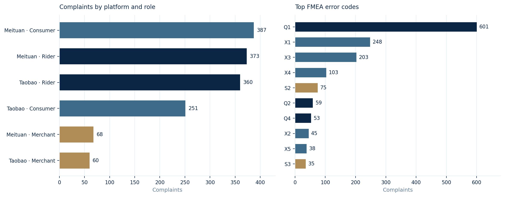
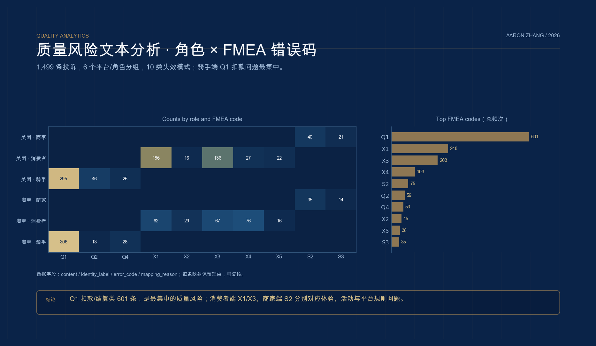

[← 返回主页](../README.md)

# 质量风险文本分析（FMEA）

> 把淘宝闪购、美团外卖的 1,499 条消费者 / 商家 / 骑手投诉，整理成带身份标签和 FMEA 错误码的质量风险数据集。

<table>
<tr>
<td><strong>项目</strong></td>
<td>质量管理课程项目 · 小组项目（全面参与）</td>
</tr>
<tr>
<td><strong>时间</strong></td>
<td>2026 春</td>
</tr>
<tr>
<td><strong>方向</strong></td>
<td>文本分类 / 质量风险 / FMEA</td>
</tr>
<tr>
<td><strong>关键词</strong></td>
<td><code>Text Classification</code> <code>FMEA</code> <code>Data Annotation</code> <code>Quality Risk</code></td>
</tr>
</table>

## 背景 / Context

平台型服务的质量问题分散在消费者、商家和骑手三端。同一条投诉，从不同角色看可能是不同的问题：消费者关心退款和体验，商家关心平台规则和结算，骑手关心派单和扣款。

项目把非结构化的投诉文本，变成可分角色查看、可对应失效模式的结构化数据，为质量风险识别和后续改进提供基础。

## 数据 / Data

- 来源：淘宝闪购、美团外卖的公开投诉/反馈文本。
- 规模：**1,499 条**。
- 六个分组：淘宝 × 消费者 / 商家 / 骑手；美团 × 消费者 / 商家 / 骑手。
- 字段：`content`（投诉原文）、`identity_label`（角色）、`error_code`（FMEA 错误码）、`mapping_reason`（映射理由）。

## 我的工作 / What I did

- 清洗投诉文本，去掉重复、无效和过短内容。
- 按消费者 / 商家 / 骑手三种身份分类。
- 将投诉映射到 FMEA 错误码，并记录映射理由，保证结果可复核。
- 按平台和角色整理成 6 个结构化 CSV，统计各错误码的出现频次。
- 输出可用于质量风险排序和后续改进的清单。

## 结果 / Results

- 形成 **1,499 条**、6 个分组的质量风险数据集。
- 骑手端的 `Q1`（扣款/结算类）出现最多，共 **601 条**；消费者端的 `X1`、`X3` 分别为 **248**、**203** 条；商家端的 `S2` 为 **75** 条。
- 数据可以直接按平台、角色、错误码筛选，用于定位高频质量问题。

## 关键数据 / Key Numbers

| 分组 | 记录数 | 主要错误码 |
|---|---:|---|
| 淘宝 · 消费者 | 251 | X1 / X3 |
| 淘宝 · 商家 | 60 | S2 / S3 |
| 淘宝 · 骑手 | 360 | Q1 / Q2 / Q4 |
| 美团 · 消费者 | 387 | X1 / X3 |
| 美团 · 商家 | 68 | S2 / S3 |
| 美团 · 骑手 | 373 | Q1 / Q2 / Q4 |
| **合计** | **1,499** | 10 类 FMEA 错误码 |

图：6 个平台/角色分组 × 10 类 FMEA 错误码的频次热力图；右侧为总频次最高的错误码。

## 结论 / Takeaways

- **Q1 扣款/结算类是最大风险池**：601 条，主要集中在骑手端；这比“整体满意度低”更能指导改进。
- **不同角色的高频问题不同**：消费者端 X1/X3（体验、活动），商家端 S2（平台规则/退款），骑手端 Q1（扣款/结算）。
- **FMEA 让文本变成可排序的风险清单**：每条投诉都有身份标签、错误码和映射理由，后续可以按角色和风险等级处理。

## 边界 / Limitations

- 错误码映射包含人工判断，存在一定主观性。
- 投诉文本只代表愿意发声的用户，不能代表全部用户体验。
- 项目重点是结构化与分类，不是因果推断；不能直接说某个错误码导致了多少损失。

## 这个项目说明了什么 / What it shows

- **文本结构化**：把非结构化投诉变成可分析的数据。
- **质量工具**：用 FMEA 的失效模式思路组织问题，而不是只做情感分析。
- **可复核性**：每条映射都保留理由，方便别人检查和修正。

---

> **说明**：案例页只展示聚合统计，不包含原始投诉文本和个人信息。
