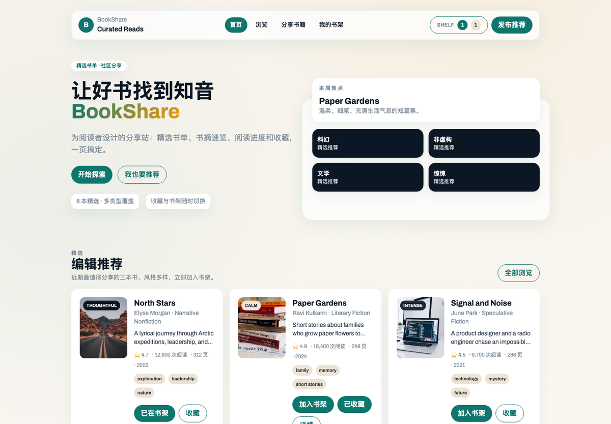
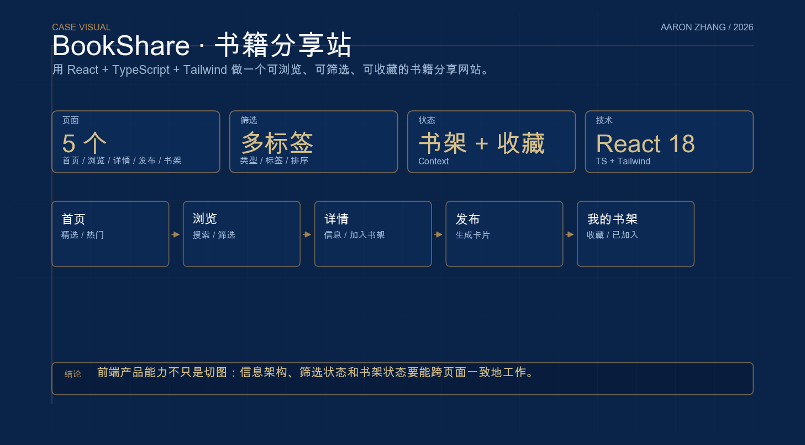

[← 返回主页](../README.md)

# BookShare · 书籍分享站

> 用 React + TypeScript + Tailwind 做一个可浏览、可筛选、可收藏的书籍分享网站。

<table>
<tr>
<td><strong>项目</strong></td>
<td>Web 开发课程项目 · 课程项目（全面参与）</td>
</tr>
<tr>
<td><strong>时间</strong></td>
<td>2025 秋</td>
</tr>
<tr>
<td><strong>方向</strong></td>
<td>前端开发 / 产品设计</td>
</tr>
<tr>
<td><strong>关键词</strong></td>
<td><code>React</code> <code>TypeScript</code> <code>Tailwind CSS</code> <code>React Router</code></td>
</tr>
</table>

## 背景 / Context

书籍推荐和收藏通常分散在电商、社交平台和笔记工具里。BookShare 想做一个更轻的入口：既能浏览和筛选书，也能把书加入自己的书架，还能发布新的书籍卡片。

## 功能 / Features

- 首页：Hero、编辑精选、热门阅读、收藏回顾
- 浏览页：搜索、类型筛选、标签筛选、按热度/评分/上新排序
- 详情页：书籍信息、标签、格式、加入书架/收藏
- 发布页：提交书籍信息，即时生成卡片加入书架
- 我的书架：查看已加入与收藏的书籍
- 响应式布局、玻璃拟态卡片、深青绿 + 暖琥珀配色

## 技术 / Stack

- Vite + React 18 + TypeScript
- Tailwind CSS（含 line-clamp 插件）
- React Router v6
- 前端状态管理：Context
- 数据：本地初始书籍与标签数据

## 我的工作 / What I did

- 参与页面结构、组件拆分和交互设计。
- 实现浏览、筛选、排序、详情、发布、书架/收藏等页面。
- 处理响应式布局和卡片状态切换。
- 整理项目结构、运行说明和后续扩展方向。

## 结果 / Results

- 完成一个包含 5 个主要页面的可运行前端原型。
- 支持搜索、多标签筛选、排序、收藏和书架状态。
- 课程项目完成；目前没有公开的线上 Demo。

## 关键数据 / Key Numbers

| 指标 | 数值 | 口径 |
|---|---|---|
| 页面 | 5 个 | 首页 / 浏览 / 详情 / 发布 / 书架 |
| 筛选 | 多标签 | 类型 / 标签 / 热度 / 评分 / 上新 |
| 状态 | 书架 + 收藏 | Context 跨页面传递 |
| 技术栈 | React 18 + TS + Tailwind | Vite + React Router |

图：首页、浏览、详情、发布、我的书架五个页面与搜索/筛选/收藏状态的关系。

## 结论 / Takeaways

- **前端产品能力不等于切图**：信息架构、筛选条件和书架状态要跨页面一致地工作。
- **状态管理决定体验**：收藏、已加入书架、筛选条件如果只在单页维护，用户很快会迷失。
- **原型边界要说明**：这是课程项目，使用本地初始数据，没有公开后端和线上 Demo。

## 这个项目说明了什么 / What it shows

- **前端产品能力**：从信息架构到组件和交互。
- **状态管理**：书架、收藏、筛选条件在页面间的传递。
- **设计落地**：把配色、字体、卡片和响应式布局做成一致的界面。

---

> **说明**：该项目为课程项目，案例页不包含完整源代码；需要时可在面试中展示。
