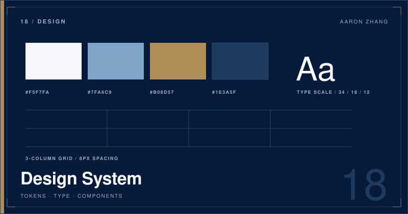
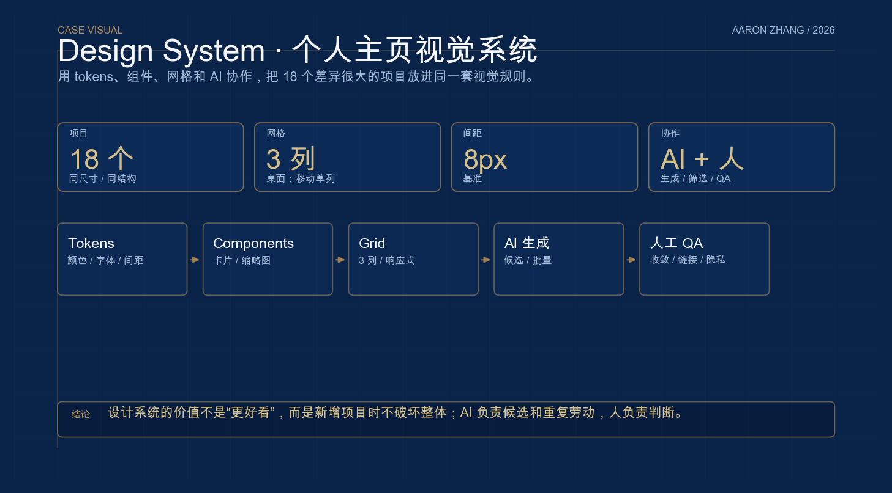

[← 返回主页](../README.md)

# Design System · 个人主页视觉系统

> 把 18 个项目放进同一套视觉规则里：颜色、字体、网格、卡片、缩略图、内容层级，以及一套我和 AI 协作的工作流。

<table>
<tr>
<td><strong>项目</strong></td>
<td>Self-initiated · 个人主页设计系统</td>
</tr>
<tr>
<td><strong>时间</strong></td>
<td>2026.11</td>
</tr>
<tr>
<td><strong>方向</strong></td>
<td>Design System / AI Collaboration / Front-end</td>
</tr>
<tr>
<td><strong>关键词</strong></td>
<td><code>Design Tokens</code> <code>Typography</code> <code>Grid</code> <code>SVG</code> <code>AI Workflow</code></td>
</tr>
</table>

## 背景 / Context

主页要同时容纳 18 个项目，项目类型从计量论文、优化模型到网站和 AI Agent。如果每个项目都用不同的封面、颜色和排版，页面会很快失去秩序。

目标不是“做得更花”，而是建立一套能持续扩展的规则：新项目加进来时，不需要重新设计一遍，也能看起来属于同一个系统。

## 设计系统 / What I built

### 1. Tokens

- 颜色：冷白 `#FFFFFF` / `#F8FAFC`，海军蓝 `#0B2545`，钢蓝 `#3E6B89`，灰蓝 `#627D98`，金色 `#B08D57`，浅灰 `#E6EDF3`。
- 字体：Helvetica Neue / Inter 体系；标题、正文、标签、数字四级。
- 间距：8px 基准；卡片内边距、分区间距、表格留白统一。
- 网格：桌面 3 列项目卡；移动端自动收为单列/双列。

### 2. Components

- 项目卡：缩略图 + 中文标题 + 类型/时间 + 一句结果 + 链接。
- 缩略图：统一 800×420 画布、左侧 8px 色条、右上角署名、底部英文项目名和大编号。
- 分区标题、引用块、表格、链接样式统一。
- 18 张缩略图全部用同一套 SVG 模板生成，只替换主题、图形和标题。

### 3. Content hierarchy

- 首页只保留 About、Projects、Experience、Toolkit、Contact 五块。
- 所有项目同尺寸、同结构，不设“主项目/次要项目”。
- 案例页统一用「背景 → 我的工作 → 结果 → 边界」结构。

## AI 协作 / How AI fits in

这套系统不是“让 AI 一键生成一个网页”，而是一个明确的人机分工：

1. **我定义问题**：主页要呈现什么、给谁看、哪些项目必须并列、什么语气。
2. **AI 生成候选**：配色、版式、SVG 缩略图、文案草稿、组件变体。
3. **我筛选和收敛**：决定哪些保留、哪些删掉，统一层级和品牌感。
4. **AI 执行重复工作**：批量生成 18 张 SVG、检查 XML、生成预览截图。
5. **我做 QA**：检查链接、移动端、内容准确性、隐私边界。

AI 在这里是**协作工具**，不是替代判断。设计系统真正的价值，是让每次新增项目都不破坏整体。

## 结果 / Results

- 18 个项目全部使用同一套卡片和缩略图规则。
- 页面从“一个大卡片 + 一个重点区”改成 3 列并列索引，信息密度更高，也更公平。
- 新增项目只需要：一个 SVG 缩略图 + 一张卡片 + 一个案例页。
- 同一套 tokens 可以继续用到简历、作品集 PDF 或个人网站。

## 关键数据 / Key Numbers

| 指标 | 数值 | 口径 |
|---|---|---|
| 项目 | 18 个 | 同尺寸、同结构 |
| 网格 | 3 列 | 桌面；移动端单列 |
| 间距 | 8px 基准 | 卡片、分区、表格统一 |
| 字体层级 | 4 级 | 标题 / 正文 / 标签 / 数字 |
| 协作 | AI + 人 | 生成候选 / 筛选 / QA |

图：tokens、组件、网格、AI 生成与人工 QA 的设计系统链路。

## 结论 / Takeaways

- **设计系统的价值是扩展性**：新增项目只需要一张缩略图、一张卡片、一个案例页，不破坏整体秩序。
- **AI 负责候选和重复劳动**：批量生成 SVG、检查 XML、生成预览；人负责判断、收敛、链接和隐私边界。
- **规则比单页美化重要**：颜色、字体、间距、网格和内容层级统一，18 个差异很大的项目才能并列。

## 这个项目说明了什么 / What it shows

- **设计系统思维**：不是单页美化，而是 tokens、组件、规则和扩展方式。
- **AI 协作能力**：知道让 AI 做什么、自己保留哪些判断。
- **前端实现**：SVG、响应式布局、GitHub Markdown 限制下的排版。
- **编辑判断**：在大量项目里做取舍，保持页面可读。

---

> **说明**：这是个人主页的设计系统，不是客户项目；页面本身就是它的应用案例。
